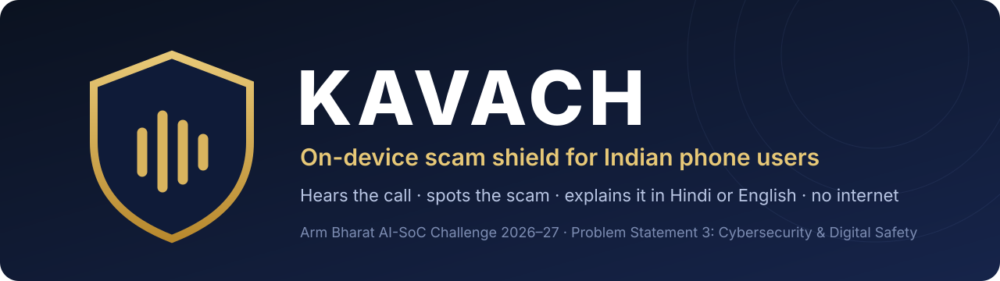
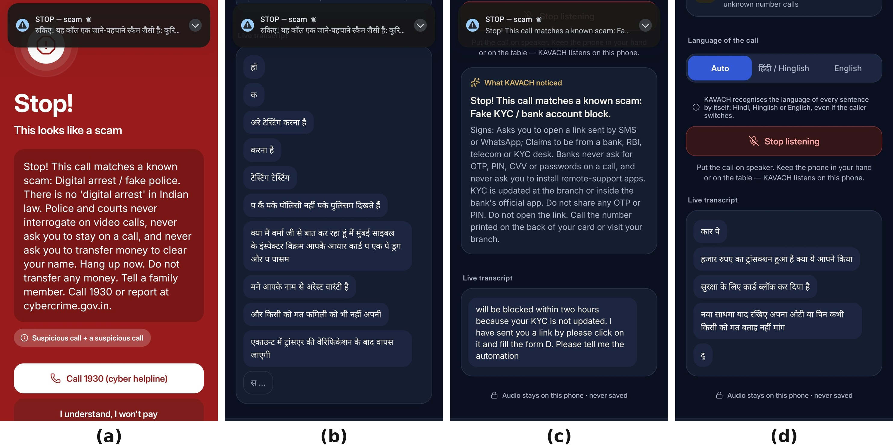
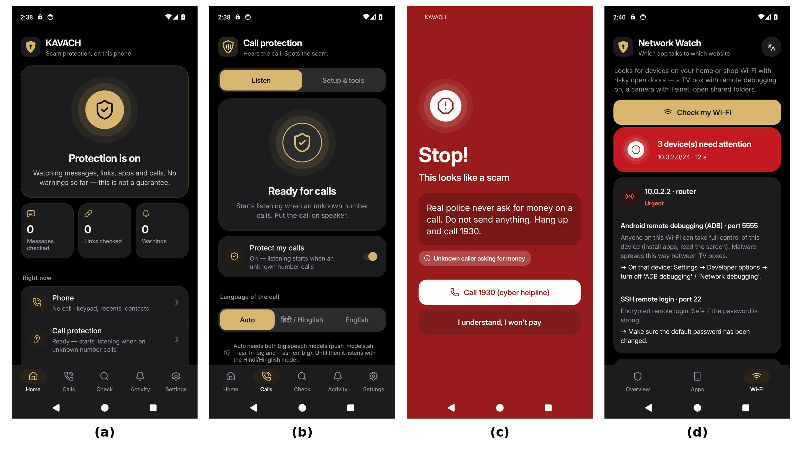
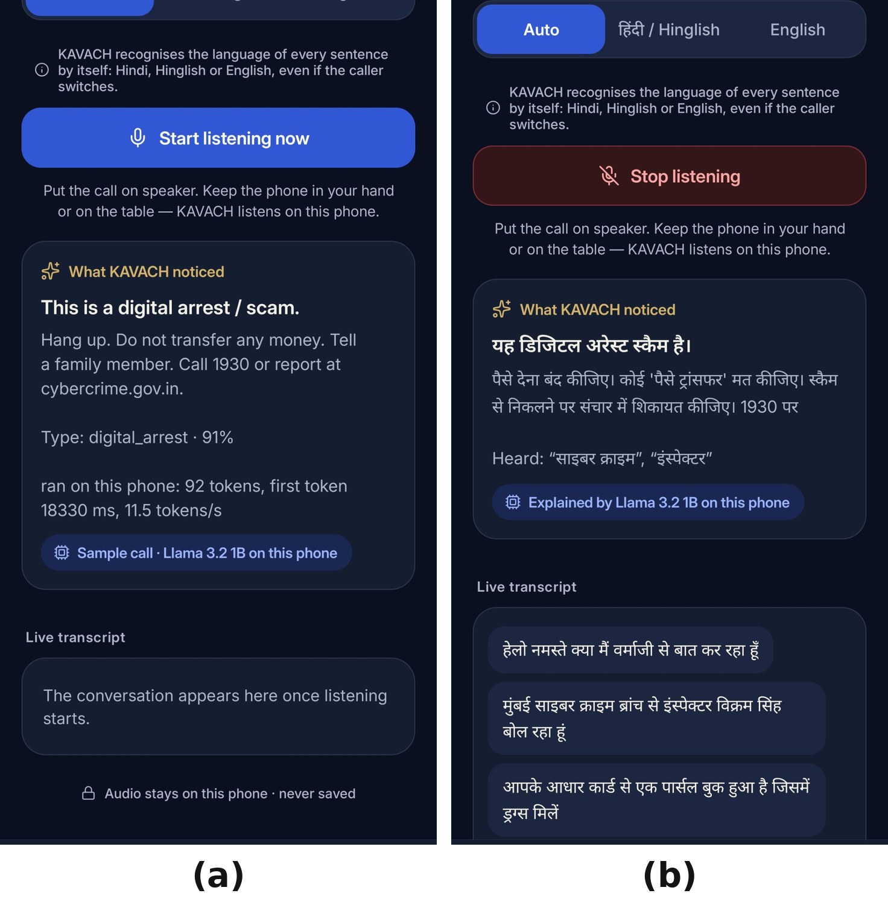
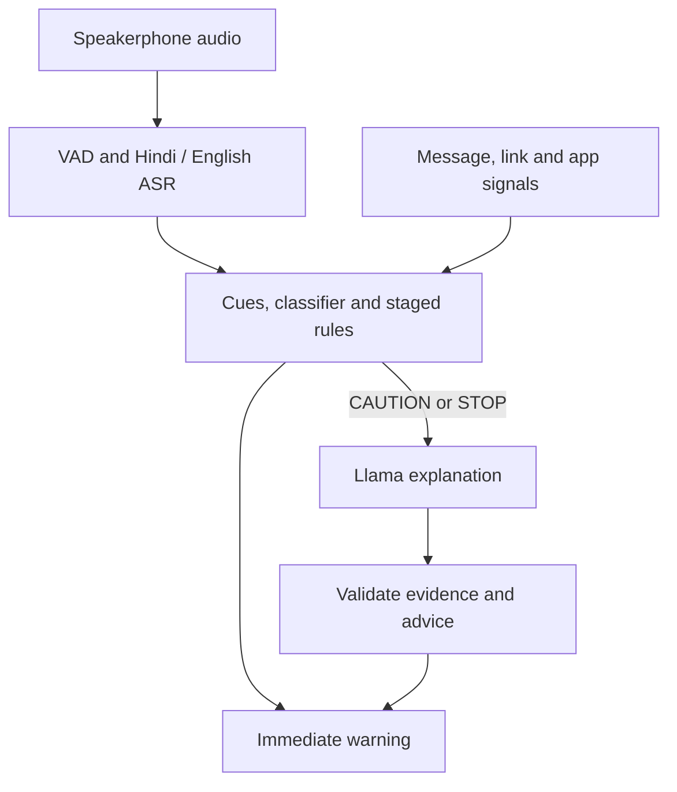

<p align="center">
  
</p>
<p align="center">
  <a href="https://github.com/siddhaantxsingh/KAVACH/releases/tag/apks-latest"></a>
  <a href="docs/KAVACH_Phase1_Report.pdf"></a>
  <a href="docs/FINISH_ROUND1.md"></a>
  <a href="docs/FREEZE_MANIFEST.md"></a>
</p>

# KAVACH

**A multilingual scam-call shield running on an Android phone’s Arm CPU.**

KAVACH listens to calls on speaker, detects suspicious patterns in Hindi, Hinglish and English, and explains warnings using an on-device Llama 3.2 1B model. Speech recognition, detection and explanation run locally. The main app has no Android `INTERNET` permission. KAVACH warns the user; it does not block transactions or guarantee that a call is safe.

Built for **Arm Bharat AI-SoC Challenge 2026–27 · PS3: Cybersecurity and Digital Safety**.

## Start here

| For reviewers | Canonical resource |
|---|---|
| Submission report | **[KAVACH_Phase1_Report.pdf](docs/KAVACH_Phase1_Report.pdf)** |
| Editable version of that same report | [KAVACH_Phase1_Report.docx](docs/KAVACH_Phase1_Report.docx) |
| Evidence, conditions and limitations | [Evidence ledger](docs/EVIDENCE_LEDGER.md) |
| Exact tested APK and model hashes | [Freeze manifest](docs/FREEZE_MANIFEST.md) |
| Install and use | [Setup guide](docs/CLICK_BY_CLICK.md) |
| Remaining Phase 1 work | [4–5 live calls and demo video](docs/FINISH_ROUND1.md) |
| Demo video | **Pending** — link will be added after recording |

There is **one submission report**, in PDF and editable Word formats. Older short-report and IEEE-manuscript versions have been removed from the current tree; their history remains in Git. Supporting guides and raw benchmark files are evidence, not alternative reports.

## What has been demonstrated

<p align="center"></p>

| Evidence | Result | Scope |
|---|---|---|
| Three live cellular role-play calls, 12 November | Hindi digital-arrest STOP; English fake-KYC STOP; genuine Hindi bank call without warning | One phone and caller; screenshots; feasibility demonstration |
| Frozen-build live-call checks, 21 November | Full fake-KYC STOP, benign scripts without warnings, explanations after warnings | Team confirms checks used live calls from a second phone; exact trial counts and per-call timing were not supplied |
| Live-call reliability checks, 21 November | Listening continued with screen locked, app backgrounded and consecutive calls; held-call/incoming-call check reported working | Qualitative team observations; missing-model fallback and dual-SIM not tested |
| Additional recorded Phase 1 set | Four required calls; optional fifth Hinglish call | **Pending** in [call sheet](demo/live_calls_phase1.csv); not included in completed results |

The team clarified on 22 November that the addendum’s functional and reliability checks used **live calls from another phone**, not self-reading beside the test phone. The separate historical acoustic-playback tests, synthetic/TTS benchmarks, model self-test and podcast battery workload retain their actual methods. Their scores are not live-call accuracy.

**Warning levels:** NONE → INFO (“worth watching”) → CAUTION → STOP. INFO alone does not invoke Llama. The English/Hindi OTP-plus-injection lines remained at INFO; that observation does **not** establish Llama prompt-injection resistance. “Too noisy” is an audio-quality hint, not a scam verdict.

<details>
<summary><b>App screens and on-device explanations</b></summary>



The interface collage is from the emulator. The following phone screenshots show Llama output; explanation source matters because a rule/playbook fallback is not model generation.



</details>

## How it works



- **Speech:** Silero VAD, AI4Bharat IndicConformer Hindi and NVIDIA Parakeet 110M English; Auto language selects the transcript.
- **Detection:** cue lexicon, hashed linear classifier and rules combining evidence across a call and other channels.
- **Explanation:** LoRA-tuned Llama 3.2 1B, quantised and exported with ExecuTorch for the Arm CPU. Generation is asynchronous; the warning does not wait for it. Llama can raise CAUTION to STOP, but cannot clear a rule warning.
- **Validation:** generated evidence must match the transcript; invalid or timed-out output leaves the rule warning in place.
- **Additional coverage:** messages, phishing links, risky app actions and optional Network Watch. Coverage and individual evaluation methods are documented in the report.

## Results with their measurement conditions

| Measurement | Result | What it establishes |
|---|---|---|
| Host detector, synthetic text, 511 scam / 489 genuine | STOP 477/511 (93.4%); before request 420/511 (82.2%); false STOP 0/489 | Synthetic text performance, without ASR or Llama |
| Small held-out text set, 10 scam / 10 genuine | STOP 8/10; before request 5/10; false STOP 0/10; false CAUTION 4/10 | Small text evaluation; not ten live calls |
| Hindi telephone-band TTS experiment | STOP 29/50 (58%) with IndicConformer, versus 0% for the earlier streaming model | Synthetic voice through a simulated channel |
| LoRA development evaluation | Scam classification 38% → 89%; valid JSON 71% → 100% | 100 synthetic development prompts, full-precision model; not independent deployed-model accuracy |
| Cross-channel fusion stress tests | Adds STOPs at risky actions; unrelated scam SMS caused call-linked STOP in 32/40 genuine-call traces | Synthetic ablation exposes false attribution; no earlier-warning improvement |

Sources, sample sizes and qualifications: [evidence ledger](docs/EVIDENCE_LEDGER.md) and Chapter 5 of the [report](docs/KAVACH_Phase1_Report.pdf).

## Measured on Arm

Test phone: **Xiaomi 2312DRA50I · Snapdragon 7s Gen 2 · Android 15**. Separate model configurations are shown separately.

| Component / workload | Observed result |
|---|---|
| Detector only | 4.07 ms per transcript sentence; excludes audio capture and ASR |
| Hindi ASR, 2 / 4 threads | RTF 0.153 / 0.092 on short benchmark clips |
| English ASR, 2 / 4 threads | RTF 0.052 / 0.037 on short benchmark clips |
| Deployed KAVACH LoRA, 820 MB, self-test | First token 18.3 s cold; decode 11.5 tokens/s |
| Stock Meta SpinQuant INT4, separate benchmark | First token 12.9 s cold / 5.9 s warm; decode 11.6–11.9 tokens/s |
| Approximately 30-minute Auto listening workload | Battery gauge 99% → 92%; temperature 35.0 → 37.1 °C; peak 37.3 °C |

The sustained run used podcast audio, with a Hindi dub for about 15 minutes. The team reports an unplugged phone, screen at about 50% brightness, Wi-Fi and wireless adb enabled. This was **not a live-call accuracy test**. Current readings were unavailable; these are whole-phone battery-gauge observations, not app-only energy or a demonstrated <10%/hour result. Thermal status was 0; that alone does not prove absence of CPU throttling. [Raw-log summary](bench/results/sustained_summary.json).

ExecuTorch/XNNPACK supports the deployment path; the precise use of KleidiAI kernels has not been profiled in this build. Thread-speed measurements exist; controlled thread-energy and backend ablations are Phase 2 work.

## Run and reproduce

The tested build is identified by [APK and model hashes](docs/FREEZE_MANIFEST.md). The mutable [APK release](https://github.com/siddhaantxsingh/KAVACH/releases/tag/apks-latest) is a convenience download; check its hash before treating it as the frozen build. Keep the existing tested installation for the final live calls.

For a fresh installation, follow [every setup step](docs/CLICK_BY_CLICK.md). Llama weights are not included in this repository. The fine-tuned KAVACH export and stock SpinQuant model are different configurations; installing the stock model does not reproduce the LoRA result.

```bash
pip install numpy scipy scikit-learn pytest wordfreq
python -m pytest -q tests
python bench/eval_calls.py --split test
python bench/summarize_sustained.py
```

The commands above are reproduction instructions, not a claim that every test was rerun for this documentation update. Fine-tuning/export: [Colab notebook](notebooks/kavach_llama_lora_colab.ipynb). Report generation: [source and build instructions](report_docx/README.md).

## Known limitations and Phase 2

1. **Live-call evidence is small.** The completed observations demonstrate feasibility, not field reliability; the final four/five calls will still be a small scripted sample.
2. **Warnings can arrive late.** STOP before the sensitive request is 50–82% on the listed text sets, below the 90% target.
3. **False warnings remain.** Genuine calls can trigger CAUTION; fusion can blame a call for an unrelated message or legitimate screen-sharing.
4. **Speech is the bottleneck.** Hindi, noise, accents and Auto-language errors affect what the detector sees. Quiet-room “Too noisy” reports remain unexplained.
5. **Llama is not independently validated at deployment scale.** It adds latency and memory use; the full-precision development scores are not a deployed-model score.
6. **Device and energy coverage are limited.** One tested phone, speakerphone/accessibility dependence, no matched app-only power study; dual-SIM and missing-model fallback remain untested.

Remaining Phase 1 work is **only the 4–5 live calls, demo video, report incorporation and submission**. The [20-call protocol](demo/pilot20/README.md) and broader experiments are deferred to Phase 2.

## Privacy and repository guide

The main app processes audio locally and does not save it. Optional family SMS, paired Bluetooth events and the separate Network Watch app have distinct data paths; see [privacy details](docs/EVIDENCE_LEDGER.md#privacy-what-leaves-the-phone). Any consented evidence recording is made separately by the team. No private call audio or phone numbers should be published here.

| Directory | Purpose |
|---|---|
| `android/` | Android app, detector, ASR/Llama integration and optional Network Watch |
| `kavach_core/` | Python reference algorithms |
| `assets/`, `data/`, `models/` | Detection assets, datasets and training/evaluation code |
| `bench/` | Reproduction scripts and saved results |
| `report_docx/` | Source for the single report |
| `docs/` | Report, evidence ledger, setup and design guides |
| `demo/` | Current live-call sheet, video guidance and deferred evaluation protocol |
| `paper/fig/` | Figure assets used by the current report; not an alternative paper |

## 👥 Team

<table>
<tr>
<td align="center" width="25%"><b>Siddhant Singh</b><br><sub>Call listening: on-device speech recognition, Call Guardian, Android app</sub></td>
<td align="center" width="25%"><b>Bogavalli Sai Akhilash</b><br><sub>Detection and Llama: scam playbook, data, classifiers, LoRA fine-tuning, evaluation</sub></td>
<td align="center" width="25%"><b>Shivansh Bose</b><br><sub>Shield and Network Watch: messages, links, apps, payments, network and Wi-Fi checks, privacy and security review</sub></td>
<td align="center" width="25%"><b>Dr. Rahul Ratnakumar</b><br><sub>Faculty mentor</sub></td>
</tr>
</table>

<p align="center"><sub>Manipal Institute of Technology, Manipal Academy of Higher Education · Arm Bharat AI-SoC Challenge 2026–27 · Problem Statement 3: Cybersecurity &amp; Digital Safety</sub></p>

### Cite

```bibtex
@misc{kavach2026,
  title  = {KAVACH: An On-Device, Multilingual Scam-Call Shield for Indian Phone Users
            with Llama 3.2 1B on Arm CPUs},
  author = {Singh, Siddhant and Akhilash, Bogavalli Sai and Bose, Shivansh and Ratnakumar, Rahul},
  year   = {2026},
  note   = {Arm Bharat AI-SoC Challenge 2026--27, Problem Statement 3, Phase 1},
  url    = {https://github.com/siddhaantxsingh/KAVACH}
}
```

---

## Licences and credits

Code: **Apache-2.0** ([LICENSE](LICENSE)). Third-party models/data: [NOTICE.md](NOTICE.md). Llama 3.2 is subject to the Llama 3.2 Community License; model weights are not redistributed here.

Built with Meta Llama, PyTorch ExecuTorch, AI4Bharat IndicConformer, NVIDIA Parakeet, sherpa-onnx and Silero VAD.
