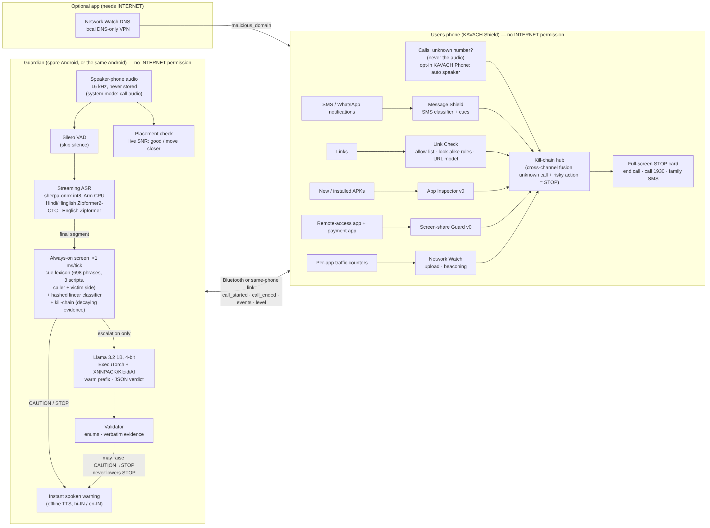

# KAVACH — on-device scam shield

**Bharat AI-SoC Challenge 2026–27 · Problem Statement 3 (Cybersecurity & Digital Safety)**

KAVACH is **one app on one Android phone**. It hears a scam call you put on speaker, connects it
to the SMS, link, app, screen-share, payment and network activity that follow, and stops the
victim **before the money moves**, explaining the trick in Hindi or English with Llama 3.2 1B
running on the phone. The app has **no `INTERNET` permission**; audio is never stored.

Three on-device pipelines feed one kill chain: **call listening** (the conversation, heard on the
same phone through Android's accessibility capture rule), **Shield** (messages, links, apps, screen
sharing, payments, and *that* an unknown-number call is going on) and **Network Watch** (what apps
send over the network, website look-ups, and a check of the home Wi-Fi for risky devices; a small
optional app, because it needs the internet permission). Setup steps: [`docs/SETUP_STEPS.md`](docs/SETUP_STEPS.md); every click: [`docs/CLICK_BY_CLICK.md`](docs/CLICK_BY_CLICK.md).

* 📄 **Phase 1 technical report:** [`docs/KAVACH_Phase1_Technical_Report.pdf`](docs/KAVACH_Phase1_Technical_Report.pdf) ([markdown](docs/technical_report.md))
* 🏗 Architecture: speech (VAD → streaming ASR on the Arm CPU) and reasoning (Llama 3.2 1B, 4-bit, ExecuTorch + XNNPACK/KleidiAI) on the Guardian; a sub-millisecond rule + classifier + kill-chain screen in front of the LLM on both phones; Network Watch on the user's phone ([`docs/network_watch.md`](docs/network_watch.md)).



## Phase 1 results (fast path only, Llama not included; no false STOP in any set)

| Evaluation set | Scam calls → STOP | STOP before money/OTP request | Genuine calls wrongly STOPped |
|---|---|---|---|
| Synthetic test, 1,000 calls, unseen phrasings | 90.6 % | 78.3 % | 0 % |
| Same, caller badly heard through the speaker | 71.1 % | 55.6 % | 0 % |
| Hand-written, 16 scam / 14 genuine | 93.8 % | 68.8 % | 0 % |
| Locked held-out, 10 / 10 (never tuned on) | 70 % | 50 % | 0 % |
| Noisy room (fan / TV / babble, 30–3 dB), 24 scam / 24 genuine audio calls | 18 / 24 | — | 0 / 24 |

Network Watch: all 5 planted threats found in a replayed capture, 0 alerts on normal browsing;
spyware uploads and remote-control heartbeats caught in 100 % of simulated traces with 0 %
false alarms on normal apps.
Other results: Kotlin port identical to the Python reference (**over 330 parity checks**); Llama
HF→ExecuTorch conversion exact (max Δlogit 3.6e-7) and the 4-bit `.pte` verified token by
token; SMS F1 0.939; Link Check flags 98.5 % of Indian look-alike domains and 0 % of genuine
Indian domains; the always-on path costs 0.44 ms per tick.
Details, limitations and what is still to be measured on phones: [report §7–9](docs/technical_report.md#results).

## Repository

```
android/        Gradle project: core (pure Kotlin detection logic + parity tests), ui (design system), shared (ExecuTorch
                Llama, TTS, links, perf stats), guardian (THE KAVACH app: call listening, benchmark; includes app),
                app (Shield part as a library: messages, links, apps, calls, Network Watch traffic, KAVACH Phone dialer),
                netwatch (optional Network Watch app: DNS watch + Wi-Fi check)
kavach_core/    Python reference implementation of every on-device algorithm
assets/         single source of truth shipped in both APKs: cue lexicon, scam playbook, genuine domains,
                app lists, linear models, demo transcripts, parity vectors
models/         classifiers/ (text + URL training), netwatch/ (domain + flow models), llama/ (SFT data, LoRA, HF->Meta, ExecuTorch export ladder,
                eval, tiny end-to-end check), asr/ (ASR-noisy training data, model notes)
data/           synth/ generators, dev/ hand-written + locked held-out calls, public/ download script
bench/          call-level eval, threshold tuning, end-to-end audio test, on-device Llama / thermal / session tools
docs/           technical report, threat model, data card, model cards, figures
demo/           90-second jury demo runbook, role-play scripts, recording protocol, consent form
scripts/        fetch Android deps, push models to phones, build APKs
tests/          pytest unit tests + parity-vector generator
```

## Quick start

```bash
# 1. Python reference + tests + evaluation (Python 3.10+)
pip install numpy scipy scikit-learn pytest
python -m pytest -q tests
./data/public/download.sh && python data/synth/generate_calls.py && python data/synth/generate_sms.py && python data/dev/build_handwritten.py
python bench/eval_calls.py --split test          # also: dev, handwritten, heldout

# 2. Android debug APKs (Android Studio / SDK 34, JDK 17)
# ready-made APKs: GitHub Releases -> apks-latest (built on every push), or build locally:
adb install -r kavach-debug.apk                  # the one KAVACH app (Releases -> apks-latest)
adb install -r kavach-netwatch-debug.apk         # optional Network Watch

# 3. Models on the phones
scripts/push_models.sh --asr                     # Hindi/Hinglish + English streaming ASR, Silero VAD (--asr-small for low-end phones)
scripts/push_models.sh --official-spinquant      # stock Llama 3.2 1B (until the KAVACH LoRA is exported)
# or your fine-tuned model: models/llama/README.md, then scripts/push_models.sh --llama <pte> <tokenizer.model>
```

**One phone is enough.** Turn on *Call listening* (an accessibility permission: during a call
Android shares the microphone only with accessibility services) and *Protect my calls*; KAVACH
then starts listening by itself when an unknown number calls and the call is on speaker. Setup:
`docs/SETUP_STEPS.md`. Phone makers could read the call audio directly instead: `docs/oem_mode.md`.

Without any models the Guardian still works in **Demo replay** mode. With ASR but no Llama
it runs the rule + classifier path, which is the fail-safe design.

## Phase 1 submission checklist (team)

- [x] Source code on GitHub — Guardian + Message/Link modules (plus previews of App Inspector & Screen-share Guard)
- [x] Technical report — `docs/KAVACH_Phase1_Technical_Report.pdf`
- [x] Debug APKs — built by GitHub on every push: Releases → `apks-latest`
- [x] ASR + Llama models on the team's Android; live English scam call reached STOP with a Llama explanation on the phone
- [ ] One real call on one phone (call listening permission) — `docs/SETUP_STEPS.md` §2
- [ ] Run **Calls → Setup & tools → Measure performance** and add the JSON to the report (`docs/benchmarks.md`)
- [ ] Record the demo video (`demo/demo_video_script.md`)
- [ ] Fill in team names below

**Team:** _name (speech & Guardian)_, _name (LLM & detection models)_, _name (Android systems & security)_ · Faculty mentor: _name_

## Licences

Code: Apache-2.0 (see `LICENSE`). Third-party components and data: [`NOTICE.md`](NOTICE.md).
Llama 3.2 is used under the Llama 3.2 Community License; **no Llama weights are in this repository**.
