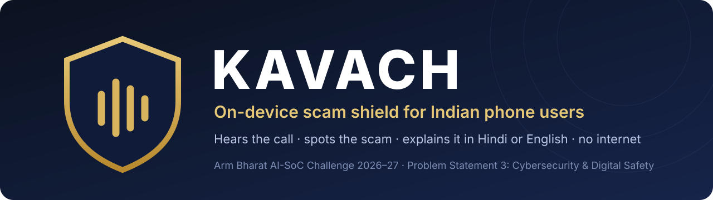
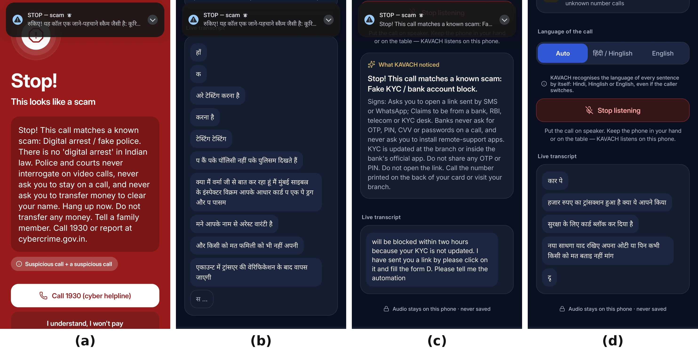
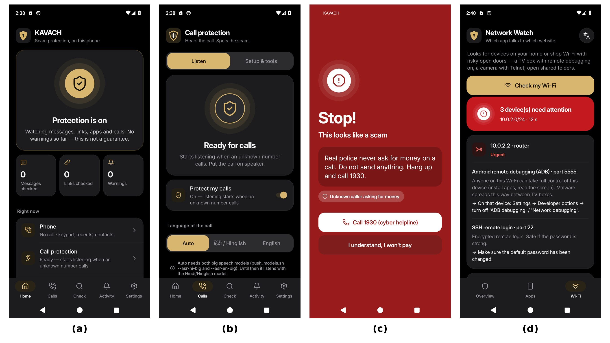
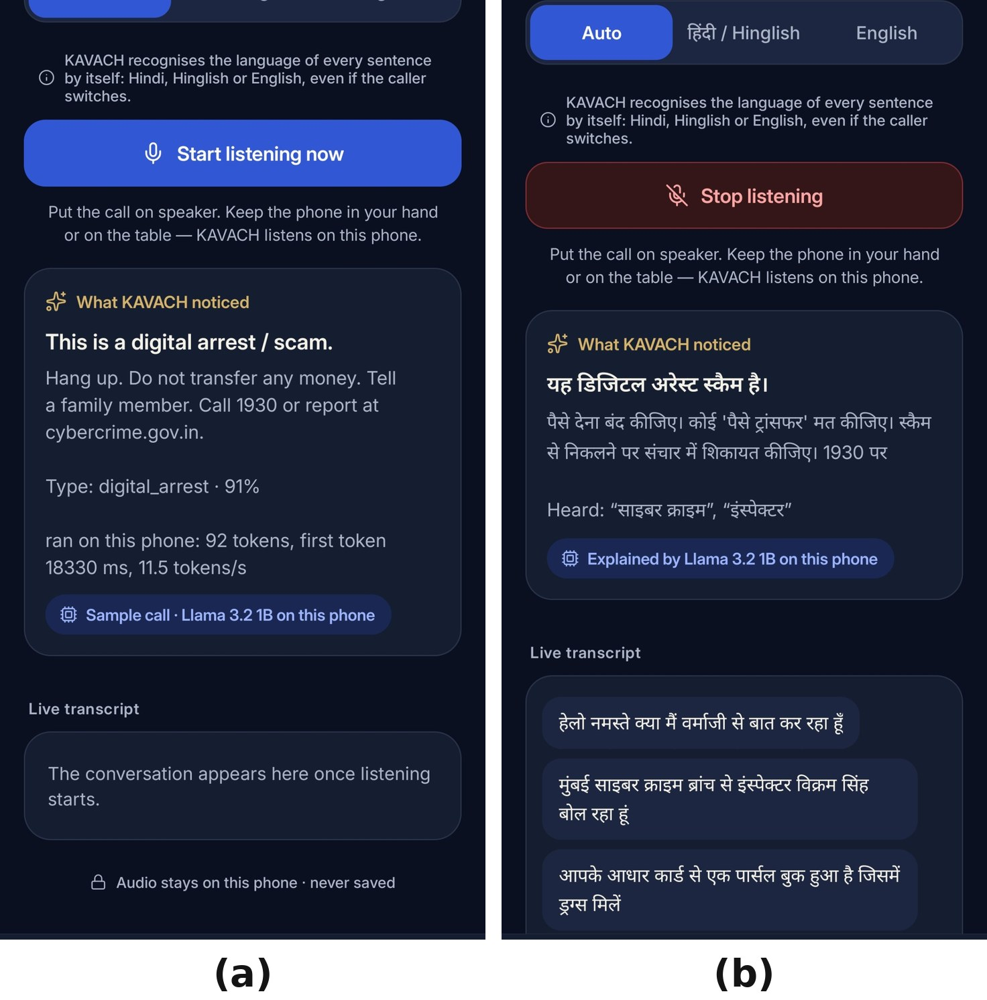
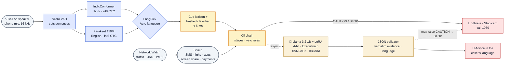
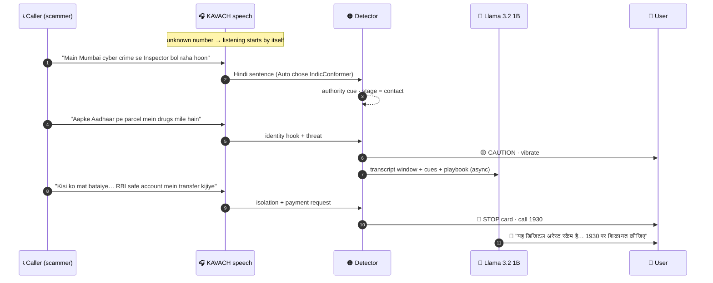
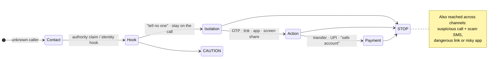
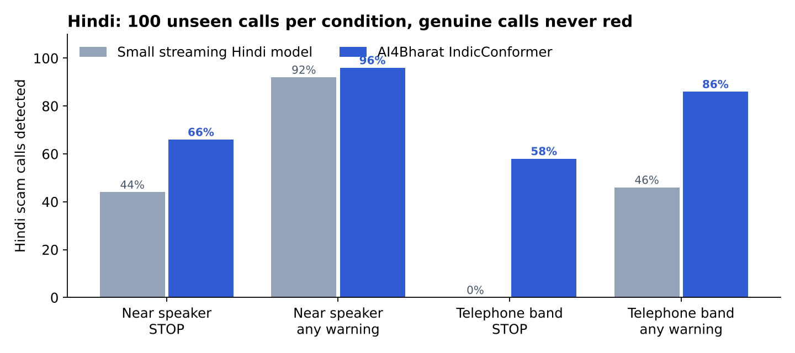
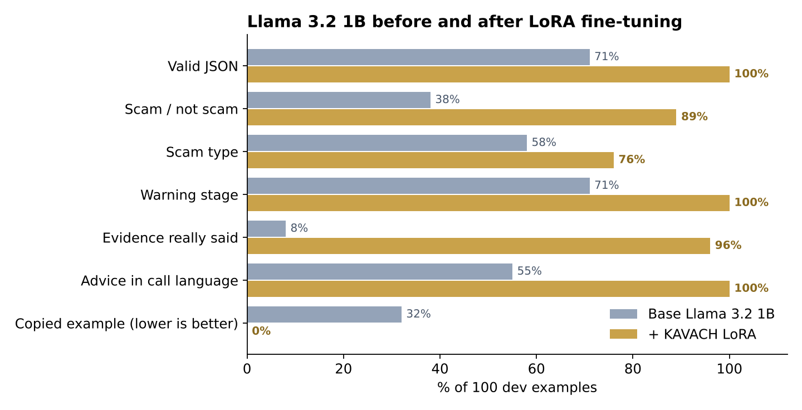
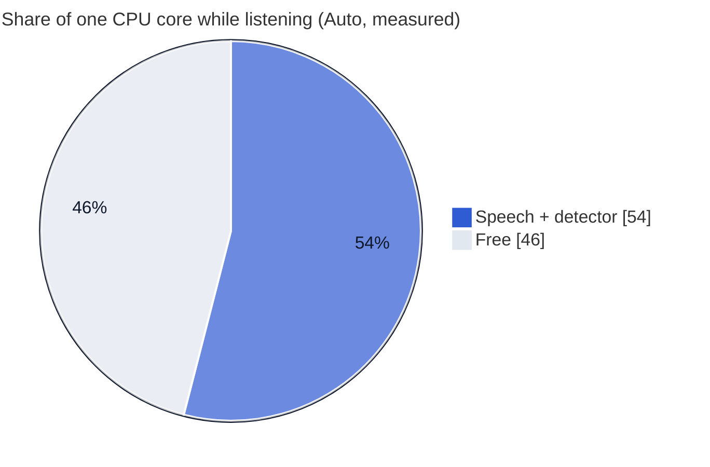

<p align="center">
  
</p>

<p align="center">
  <a href="https://github.com/siddhaantxsingh/KAVACH/releases/tag/apks-latest"></a>
  <a href="docs/KAVACH_IEEE_Paper.pdf"></a>
  <a href="docs/KAVACH_Phase1_Technical_Report.pdf"></a>
</p>

<p align="center">
  
  
  
  
  
  
  
</p>

<p align="center">
  <b>One app. One phone. No internet.</b><br>
  KAVACH listens to a suspicious call you put on speaker, understands Hindi, Hinglish and English <i>on the phone</i>,<br>
  and stops you <b>while the call is still going</b>, before the money moves, explaining the trick with Llama&nbsp;3.2&nbsp;1B running on the Arm CPU.
</p>

<p align="center">
  <a href="#-see-it-work">See it work</a> ·
  <a href="#-how-it-works">How it works</a> ·
  <a href="#-results">Results</a> ·
  <a href="#-arm-performance">Arm performance</a> ·
  <a href="#-quick-start">Quick start</a> ·
  <a href="#-repository">Repository</a> ·
  <a href="#-team">Team</a>
</p>

---

## ⚡ At a glance

<table>
<tr>
<td width="25%" align="center"><h3>3 / 3</h3>real cellular calls on one phone behaved correctly: Hindi scam <b>STOP</b>, English scam <b>STOP</b>, genuine bank call <b>calm</b></td>
<td width="25%" align="center"><h3>0 STOPs</h3>on genuine calls in every evaluated set (489 synthetic, 24 human-written); genuine calls still get CAUTION 5–40 % of the time</td>
<td width="25%" align="center"><h3>385 mA</h3>whole-phone current in a one-minute run of listening with <b>both</b> speech models (≈ 7.6 % battery/h if it held), no heating</td>
<td width="25%" align="center"><h3>38 → 89 %</h3>Llama scam accuracy after LoRA; copied advice <b>32 → 0 %</b>, right language <b>55 → 100 %</b></td>
</tr>
</table>

> [!IMPORTANT]
> The main app **does not request Android's `INTERNET` permission**: speech, detection and Llama all run on the phone, and audio is never stored. What *can* leave the phone is optional and user-enabled: an SMS to one family member, a Bluetooth link to a paired KAVACH phone, and the separate Network Watch app's DNS forwarding ([`docs/EVIDENCE_LEDGER.md`](docs/EVIDENCE_LEDGER.md#privacy-what-leaves-the-phone)).

> [!NOTE]
> Every number below has a row in the **[evidence ledger](docs/EVIDENCE_LEDGER.md)** (source file, sample size, and whether it was reproduced, measured once, observed or is still planned). Host results were re-run on 12 Nov 2026 with the shipped models.

---

## 🎬 See it work

**Real cellular calls from an unknown number, answered in the phone's own dialer and put on speaker. KAVACH started by itself, language on Auto.**

<p align="center"></p>

| | Call | What KAVACH did |
|:-:|---|---|
| **(a)** | Hindi "digital arrest" scam: fake police, Aadhaar parcel, arrest warrant, "tell no one", RBI safe account | 🔴 Full-screen **Stop** card during the call |
| **(b)** | The same call, live transcript through the phone line | Hindi heard almost word for word |
| **(c)** | English fake-KYC scam: account blocked, link by SMS, OTP | 🔴 **STOP**, "Fake KYC / bank account block" |
| **(d)** | Genuine Hindi bank fraud-check call: card, transaction, OTP and PIN mentioned | 🟢 **No warning** |

<details>
<summary><b>📱 The app and Llama on the phone</b> (click to open)</summary>
<br>
<p align="center"></p>
<p align="center"><i>Home with live status · Call protection with Auto language · Stop card for a scam SMS and link · Network Watch finding risky devices on the home Wi-Fi</i></p>
<p align="center"></p>
<p align="center"><i>Fine-tuned Llama 3.2 1B on the phone: own advice in English (self-test, 11.5 tokens/s) and in Hindi during a Hindi call, with evidence quoted word for word.</i></p>
</details>

---

## 🧠 How it works



| Layer | What it does | Why it matters |
|---|---|---|
| 🔵 **Speech** | Silero VAD cuts sentences; **AI4Bharat IndicConformer** (Hindi) and **NVIDIA Parakeet 110M** (English), int8, recognise each whole sentence. In **Auto** both run on every sentence and **LangPick** keeps the one whose words are real words of its language. | Callers switch between English and Hindi mid-call; Hinglish goes to the Hindi model, which also writes English loanwords. |
| 🟠 **Detector** | A cue lexicon (authority, identity hook, threat, isolation, credential, payment), a hashed linear classifier over the last 120 tokens, and a **kill chain** that combines cues over time and across channels. Context rules veto false alarms ("never share your OTP" is advice, not a threat). | Reacts in about **4 ms** per sentence; never waits for the LLM. |
| 🟡 **Llama** | Llama 3.2 1B, LoRA-tuned on KAVACH's scam playbook, 4-bit, ExecuTorch on the Arm CPU. Returns strict JSON; a validator keeps only evidence quoted word for word and replaces copied or wrong-language advice. | Explains the trick in the caller's language; can raise CAUTION to STOP, can **never** lower a rule STOP. |
| 🔴 **User** | Vibration and a full-screen Stop card with the 1930 cyber helpline. Nothing is spoken into a live call. | Works while the user is in the phone app. |

### A scam call, second by second



### The kill chain



---

## 📊 Results

### Call-level detection (host, replayed in call time, no Llama)

| Evaluation set | Scam → **STOP** | STOP before the money/OTP request | Median time to STOP | Genuine STOPped | Genuine at CAUTION |
|---|:-:|:-:|:-:|:-:|:-:|
| Synthetic test, 511 scam / 489 genuine | **477 (93.4 %)** | 420 (82.2 %) | 12.6 s | **0** | 29 (5.9 %) |
| Same, caller heard through a speaker | **375 (74.7 %)** | 304 (60.6 %) | 14.6 s | **0** | 26 (5.2 %) |
| Hand-written, 16 / 14 | **15** | 10 | 19.0 s | **0** | 3 |
| Locked held-out, 10 / 10 (never tuned on) | **8** | 5 | 21.3 s | **0** | 4 |

Zero false STOPs on 24 human-written genuine calls does not prove a ≤ 2 % rate (95 % upper bound ≈ 14 %), and warnings before the money step (50–82 %) are below our 90 % target.

### Does cross-channel fusion help? (ablation)

[`bench/fusion_ablation.py`](bench/fusion_ablation.py) replays identical event traces with the call detector alone, the message/app detectors alone, both combined independently, and full fusion. **Fusion turns an ambiguous call into STOP at the risky action** (APK install during a call: 30 → 40 of 40; a call heard only in part + APK: 7 → 40), **but it never warned earlier** than the independent combination, and most of the gain comes from *knowing* an unknown-number call is on. It also has costs: an unrelated scam SMS during a genuine call is blamed on the call (32/40), and work screen-sharing during an unknown-number call is STOP. Full tables: [technical report §7.10](docs/technical_report.md).

### Hindi speech: the fix that mattered

<p align="center"></p>

Over a telephone line, the small streaming Hindi model caught **0 %** of scams at STOP. AI4Bharat IndicConformer, recognising whole sentences, reaches **58 %** STOP and **86 %** any warning, with genuine calls never red.

### Auto language

On held-out sentences LangPick chose the right model **92.7 %** of the time (Hindi 91–99 %, English 87–93 %), and all six test calls replayed on the phone behaved as expected.

### Llama 3.2 1B: before and after LoRA

<p align="center"></p>

LoRA r = 16 on all projections, 1 epoch over 4,000 KAVACH instruction pairs, trained on a free Colab T4 in 4.1 h ([`notebooks/kavach_llama_lora_colab.ipynb`](notebooks/kavach_llama_lora_colab.ipynb)). Scored on 100 dev examples with the **full-precision** merged model; the dev data shares the generator with training, so this measures learning of the task, not human speech. The deployed 4-bit file is so far only observed on the phone. Llama can raise CAUTION to STOP but **never lowers or clears a warning**; a timed-out or invalid answer leaves the rule-based warning in place.

---

## 🚀 Arm performance

Measured on a **Xiaomi 2312DRA50I** · Snapdragon 7s Gen 2 (4 × Cortex-A78 @ 2.4 GHz + 4 × Cortex-A55 @ 1.96 GHz) · Android 15 · **on battery** · [`bench/results/device/`](bench/results/device/)

| Component | Result |
|---|---|
| 🟠 Detector (cues + classifier + kill chain) | **4.07 ms** per sentence |
| 🔵 IndicConformer Hindi (sentence) | RTF **0.153** at 2 threads · 0.092 at 4 (6.5× / 10.9× faster than real time) |
| 🔵 Parakeet 110M English (sentence) | RTF **0.052** at 2 threads · 0.037 at 4 (19× / 27×) |
| 🔋 Auto listening, both models on every sentence (**one-minute** run, screen on) | **54 % of one core · 385 mA whole phone** (≈ 7.6 % battery/h if extrapolated) · 38.0 → 37.9 °C · no throttling |
| 🦙 Llama 3.2 1B, Meta SpinQuant INT4 `.pte` | load 4.1 s · +1.1 GB · first token **5.9 s** warm / 12.9 s cold · full answer 15.1 s / 22.0 s · decode **11.6–11.9 tok/s** |
| 🦙 Llama 3.2 1B + KAVACH LoRA, 8da4w `.pte` (820 MB) | self-test: first token 18.3 s cold · decode **11.5 tok/s** |

Single runs on one phone. A 30-minute soak with an idle baseline, 2 vs 4 threads energy and KleidiAI on/off are scripted but not yet run.



**Arm-specific choices:** int8 ONNX speech models on sherpa-onnx; Llama exported with 8-bit dynamic activations and 4-bit groupwise weights (g = 32) plus 4-bit embeddings for **XNNPACK / KleidiAI** int4 kernels; the constant Llama system prefix is pre-filled into the KV cache when a call starts; thread counts measured at 1/2/4 per model.

---

## 🛡️ What KAVACH covers (PS3)

| Threat | KAVACH | Where |
|---|---|---|
| 📞 Scam calls (digital arrest, fake KYC, courier, family emergency, …) | live listening on one phone, Hindi/Hinglish/English, STOP during the call | `android/guardian` |
| 💬 SMS / chat scams | notification reader + SMS model (F1 0.945) | `android/app` |
| 🔗 Phishing links | allow-list, Indian look-alike rules, URL model: 98.5 % of look-alikes flagged, 0 % of genuine Indian domains | `android/core` |
| 📲 Screen-share and remote-access tricks | payment app opened while a remote-access app is in front | `android/app` |
| 🌐 Network threats | Network Watch: per-app traffic, DNS look-ups, risky devices on home Wi-Fi (ADB 5555, Telnet, RDP, SMB, TR-069…) | `android/netwatch` |
| 🧾 Explanation and remedy | Stop card, 1930 helpline, Llama advice in the caller's language | everywhere |

---

## 🏁 Quick start

<details open>
<summary><b>1 · Install on an Android phone</b> (Windows Git Bash / macOS / Linux, phone with USB debugging)</summary>

```bash
# the KAVACH app and the optional Network Watch app (built by GitHub Actions on every push)
curl -L -o kavach-debug.apk https://github.com/siddhaantxsingh/KAVACH/releases/download/apks-latest/kavach-debug.apk
adb install -r kavach-debug.apk

# speech models (Hindi IndicConformer + English Parakeet + Silero VAD), from this repo's releases
scripts/push_models.sh --asr

# Llama: your fine-tuned .pte from the Colab notebook, or Meta's stock model
scripts/push_models.sh --llama kavach_llama3_2_1b.pte tokenizer.model
scripts/push_models.sh --official-spinquant
```

Then in the app: **Home → Finish setup** (message checking, screen-share guard, **call listening**, turn on protection). Every click: [`docs/CLICK_BY_CLICK.md`](docs/CLICK_BY_CLICK.md).
</details>

<details>
<summary><b>2 · Reproduce the host results</b> (Python 3.10+)</summary>

```bash
pip install numpy scipy scikit-learn pytest wordfreq
python -m pytest -q tests                              # unit tests + Python/Kotlin parity vectors
python data/synth/generate_calls.py                    # synthetic calls (train / dev / test)
python bench/eval_calls.py --split test                # also: dev, handwritten, heldout
```
</details>

<details>
<summary><b>3 · Fine-tune Llama yourself</b> (free Colab T4, about 5 h)</summary>

Open [`notebooks/kavach_llama_lora_colab.ipynb`](notebooks/kavach_llama_lora_colab.ipynb) in Colab → Runtime → T4 GPU → Run all. It scores the base model, trains the LoRA, scores again, exports the ExecuTorch 1.4 `.pte` and saves everything to Google Drive.
</details>

<details>
<summary><b>4 · Measure performance on your phone</b></summary>

KAVACH → **Calls → Setup & tools → Measure performance** (USB unplugged). Results are saved as JSON: [`docs/benchmarks.md`](docs/benchmarks.md).
</details>

---

## 🗂️ Repository

```text
KAVACH/
├── android/            Kotlin, no AndroidX
│   ├── core/           pure-Kotlin detection logic (cues, classifier, kill chain, LangPick, Llama contract) + parity tests
│   ├── guardian/       THE KAVACH app: call listening, speech engines, Llama advisor, benchmark
│   ├── app/            Shield: messages, links, apps, screen share, payments, KAVACH Phone dialer
│   ├── shared/  ui/    ExecuTorch Llama runtime, TTS, links, design system
│   └── netwatch/       optional Network Watch app (DNS watch, Wi-Fi check)
├── kavach_core/        Python reference of every on-device algorithm (kept identical to Kotlin)
├── assets/             cue lexicon, scam playbook, language word lists, linear models, parity vectors
├── models/             classifier training, ASR data tools, Llama SFT data / LoRA / ExecuTorch export
├── notebooks/          Colab: Llama 3.2 1B LoRA + ExecuTorch export
├── data/  bench/       synthetic call generators, evaluation, benchmarks, results (incl. phone JSON)
├── paper/              IEEE-format paper (LaTeX)
├── docs/               technical report, IEEE paper PDF, threat model, model and data cards, setup guides
└── demo/               demo video script, role-play scripts, recording protocol, consent form
```

---

## 🔒 Privacy and safety by design

- **No `INTERNET` permission** in the main app: no audio, transcript or model output can be uploaded by it. Optional, user-enabled paths (family SMS, paired Bluetooth phone, the separate DNS-watch app) are listed in the [evidence ledger](docs/EVIDENCE_LEDGER.md#privacy-what-leaves-the-phone).
- The second-phone Bluetooth link accepts **paired devices only** over an encrypted channel, caps message size and treats incoming events as evidence, never commands.
- **Audio is never stored**: it lives in memory for the length of a sentence.
- The call-listening accessibility service **reads no screen content and performs no actions**; it exists only because Android shares the microphone during a call with accessibility services ([docs](https://developer.android.com/media/platform/sharing-audio-input)).
- If Android silently stops that service, the app **detects it** and says how to fix it, instead of failing quietly.
- KAVACH **warns; it never blocks payments** and never claims to.
- Threat model: [`docs/threat_model.md`](docs/threat_model.md) · audit: [`docs/AUDIT_AND_COMPLIANCE.md`](docs/AUDIT_AND_COMPLIANCE.md).

---

## 🧭 Honest limits and Phase 2

- [x] Real calls on one phone: Hindi scam STOP, English scam STOP, genuine calm (3/3)
- [x] Phone benchmark: speed, memory, battery, heat
- [x] Llama 3.2 1B fine-tuned and running on the phone in Hindi and English
- [x] Cross-channel fusion ablation with counterexamples ([§7.10](docs/technical_report.md))
- [ ] 20-call locked human pilot, frozen build, two annotators ([`demo/pilot20/`](demo/pilot20/)), planned 21 Nov
- [ ] Deployed 4-bit Llama scored on independent, ASR and prompt-injection prompts
- [ ] 30-minute listening soak with an idle baseline; 2 vs 4 threads energy
- [ ] NPU offload of the speech encoders with CPU-vs-NPU energy measurements
- [ ] Quantisation ladder and KleidiAI on/off ablations on big and LITTLE cores, and on a budget phone
- [ ] "Warned before payment" ≥ 90 % (today 50–82 % depending on the set)
- [ ] Entity-aware fusion (organisation on the call vs message sender)

All accuracy numbers except the real calls use synthetic text or TTS voices; human voices will score lower. Details: [technical report §7–9](docs/technical_report.md).

---

## 👥 Team

<table>
<tr>
<td align="center" width="25%"><b>Siddhant Singh</b><br><sub>Call listening: on-device speech recognition, Call Guardian, Android app</sub></td>
<td align="center" width="25%"><b>Bogavalli Sai Akhilash</b><br><sub>Detection and Llama: scam playbook, data, classifiers, LoRA fine-tuning, evaluation</sub></td>
<td align="center" width="25%"><b>Shivansh Bose</b><br><sub>Shield and Network Watch: messages, links, apps, payments, network and Wi-Fi checks, privacy and security review</sub></td>
<td align="center" width="25%"><b>Dr. Rahul Ratnakumar</b><br><sub>Faculty mentor</sub></td>
</tr>
</table>

<p align="center"><sub>Manipal Institute of Technology, Manipal Academy of Higher Education · Arm Bharat AI-SoC Challenge 2026–27 · Problem Statement 3: Cybersecurity &amp; Digital Safety</sub></p>

### Cite

```bibtex
@misc{kavach2026,
  title  = {KAVACH: An On-Device, Multilingual Scam-Call Shield for Indian Phone Users
            with Llama 3.2 1B on Arm CPUs},
  author = {Singh, Siddhant and Akhilash, Bogavalli Sai and Bose, Shivansh and Ratnakumar, Rahul},
  year   = {2026},
  note   = {Arm Bharat AI-SoC Challenge 2026--27, Problem Statement 3, Phase 1},
  url    = {https://github.com/siddhaantxsingh/KAVACH}
}
```

---

## 📜 Licences and credits

Code: **Apache-2.0** ([`LICENSE`](LICENSE)). Third-party models and data: [`NOTICE.md`](NOTICE.md).
Llama 3.2 is used under the Llama 3.2 Community License; **no Llama weights are in this repository**.
Built on Meta Llama · PyTorch ExecuTorch · Arm KleidiAI · AI4Bharat IndicConformer · NVIDIA Parakeet · k2-fsa sherpa-onnx · Silero VAD · Piper · wordfreq.

<p align="center"><sub>If you get a call like this in real life: hang up, don't pay, and call <b>1930</b> or report at <a href="https://cybercrime.gov.in">cybercrime.gov.in</a>.</sub></p>
