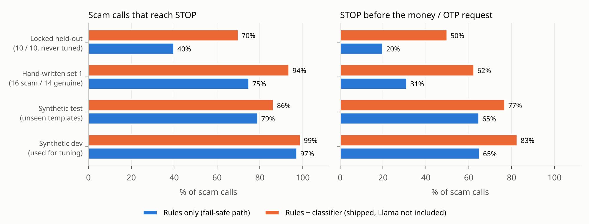

**Team:** Siddhant Singh (call listening: on-device speech recognition, Call Guardian
and the Android app) · Bogavalli Sai Akhilash (detection and Llama: scam playbook, data, classifiers,
LoRA fine-tuning and evaluation) · Shivansh Bose (Shield and Network Watch: messages, links, apps,
payments, network and Wi-Fi checks, privacy and security review) · **Faculty mentor:**
Dr. Rahul Ratnakumar.
All three members worked across every part of the project; the roles name each person's main area.

# 1. Summary

KAVACH is **one app on one Android phone**. It listens to a suspicious call the user has put
on speaker (with consent), understands it on the phone, and stops the victim before money moves.
It joins what it hears with the SMS, link, app, screen-share, payment and network activity that
follow, because real Indian scams move across channels. **Nothing leaves the device:** the app
does not request the Android `INTERNET` permission.

KAVACH runs **three on-device pipelines** that feed one kill chain: **call listening** (the
conversation), **Shield** (messages, links, apps, screen sharing, payments, and *that* a call
with an unknown number is going on), and **Network Watch** (what installed apps send over the
network, the website names they look up, and risky devices on the home Wi-Fi). Each one works
alone; together they cover the whole scam.

**What exists at the Phase 1 freeze** (all in this repository):

* **One Android app + one optional app** (Kotlin, no AndroidX, built on every push by GitHub
  Actions and checked on an Android 14 emulator with screenshots of every screen):
  *KAVACH* (streaming Hindi/Hinglish or English ASR, Call Guardian, Llama 3.2 1B advisor, live
  placement check, **one-phone call listening** through Android's accessibility capture rule
  (§3.5), "Protect my calls" auto-start, Message Shield, Link Check, call awareness, app-traffic
  detector, App Inspector, Screen-share Guard, opt-in KAVACH Phone dialer, kill-chain hub, STOP
  card, on-phone performance benchmark), and the optional *KAVACH Network Watch* app (DNS watch
  and a home Wi-Fi check, §3.6). It is separate only because it needs the internet permission.
* **Measured on the team's phone (Xiaomi, Android 14):** a live English scam call played through
  a speaker reached STOP, and Llama 3.2 1B (SpinQuant INT4, ExecuTorch) explained it on the phone:
  first token 7.2 s with the warm system prefix, 10.1 tokens/s decode (§7.5).
* **A Python reference implementation** of every on-device algorithm, with the Kotlin port
  proven identical by **over 330 parity checks**, including tick-by-tick replays of whole calls.
* **The Llama pipeline** (LoRA data, fine-tuning, Hugging Face→Meta conversion,
  ExecuTorch 4-bit export ladder, evaluation), **verified end to end** on a tiny
  Llama-3.2-shaped model: conversion is exact (max logit difference 3.6e-7), and the exported
  `.pte` reproduces Hugging Face token by token through the KV cache.
* **Evaluation harnesses** and first results, all on held-out data.

**Headline results.** These cover the always-on path (rules + classifier) *without*
Llama; no false STOP was raised on any genuine call in any set:

| Evaluation set | Scam calls reaching STOP | STOP before the money/OTP request | Genuine calls wrongly STOPped |
|---|---|---|---|
| Synthetic test, 1,000 calls, phrasings never trained on | **90.6 %** | 78.3 % | **0 %** |
| Same, caller heard through the speaker (3× ASR errors on the caller's lines) | 71.1 % | 55.6 % | **0 %** |
| Hand-written calls, 16 scam / 14 genuine | **93.8 %** | 68.8 % | **0 %** |
| Locked held-out calls, 10 / 10, never used for tuning | **70 %** | 50 % | **0 %** |
| Noisy-room audio: TTS call → speaker-phone → fan / TV / babble at 30–3 dB → ASR, 24 scam / 24 genuine | 18 of 24 (6/6 at 30 and 15 dB) | — | **0 of 24** |

Network Watch (§7.6): all 5 planted threats found in a replayed capture with no alert on normal
browsing; in 200 simulated traces per scenario, spyware uploads and remote-control heartbeats
are caught every time, with 0 % false alarms on normal app use.

The honest reading: the fast path is safe, with no false STOPs anywhere, but on unseen phrasing
it leaves about 10 % of scam calls at CAUTION (about 30 % when the caller is badly heard). That
gap is what the Llama 3.2 1B layer is for: it judges every CAUTION and may escalate it to STOP.
Measuring that on phones is the first Phase 2 milestone (§9). The other bottleneck is speech
recognition when a TV or other people are talking in the room (§7.3).

# 2. Problem and scope

Indians lost ₹22,495 crore to cyber fraud in 2025 (MHA/I4C). "Digital arrest" calls alone
caused 1.24 lakh cases and ₹1,918 crore of losses in 2024. A scam is a *sequence*: an
authority claim, a threat or lure, isolation ("don't disconnect, don't tell your family"), an
action (OTP, link, APK, screen share) and a payment. Single-channel filters see one fragment.
On-device call-scam detection exists only on premium phones. KAVACH targets the budget and
mid-range Android phones most families own, explains every alert in Hindi or English, and
gives the next step (hang up, call 1930).

Since Android 10, third-party apps cannot capture call audio. The **Guardian** therefore listens
to the call on speaker, from a spare Android or from the same Android when the call is on
another phone. That has three costs, and Phase 1 now addresses each of them:

| Drawback | What KAVACH does about it | Section |
|---|---|---|
| Needs an extra device | **One-phone mode**: Shield alone knows *that* an unknown-number call is going on and stops risky actions during it; **OEM/system mode**: the same Guardian APK reads the call audio directly when a phone maker ships it as a privileged app | 3.5, 3.7 |
| The victim must put the call on speaker | **KAVACH Phone** (opt-in dialer role) puts unknown callers on speaker itself after a spoken notice; otherwise a "turn on speaker" nudge when a Guardian is linked | 3.5 |
| Noisy rooms | a bigger English recogniser (3× more noisy scam calls reach STOP), a live **placement check**, victim-side cues (the victim sits next to the Guardian), and fusion with actions that need no audio at all | 3.1, 7.3 |

# 3. Architecture


## 3.1 Pipeline A — speech (Guardian, Arm CPU; NPU in Phase 2)

| Stage | Implementation | Notes |
|---|---|---|
| Capture | `AudioRecord`, `VOICE_RECOGNITION` source, 16 kHz mono, 100 ms chunks | AGC/noise suppression off; audio never written to storage |
| VAD | Silero VAD (sherpa-onnx), 512-sample windows | decoding is skipped after 1.5 s of silence; audio is still buffered, so nothing is lost |
| Streaming ASR — Hindi/Hinglish | Zipformer2-CTC, int8, Devanagari characters (`betterflow-hindi-streaming-ctc`, Apache-2.0) | writes English loan words in Devanagari; the cue lexicon covers both scripts |
| Streaming ASR — English | Zipformer transducer `en-2023-06-21`, int8, 188 MB (k2-fsa); the 20M model remains for low-end phones (`push_models.sh --asr-small`) | host RTF 0.12 (20M: 0.05); chosen by the noisy-room benchmark, §7.3 |
| Placement check | 20 ms frame powers over the last 5 s; 90th vs 10th percentile → SNR estimate; "good / move closer / too noisy" on screen | no audio kept; thresholds calibrated in §7.3 |
| Endpointing | trailing silence 0.8 s, or 12 s maximum utterance | each final segment triggers an immediate engine tick |

**Design decision from this phase.** The proposal named a Hindi FastConformer streaming
model. Its maintainers document that it needs a patched sherpa-onnx feature extractor and
cannot write Latin script (12 WER points worse on Hinglish). We therefore ship the
Zipformer2-CTC model, which runs on the stock runtime and handles Hinglish. The NPU export of
speech models (ExecuTorch Qualcomm/MediaTek backends) is Phase 2.

## 3.2 Pipeline B — reasoning (Llama 3.2 1B, ExecuTorch, Arm CPU)

| Item | Choice |
|---|---|
| Model | Llama-3.2-1B-Instruct + KAVACH LoRA (r = 16, all projections), merged before export |
| Runtime | ExecuTorch `LlmModule` (Android AAR), XNNPACK delegate; KleidiAI int4 micro-kernels are enabled by default on Arm |
| Quantisation (shipped) | 8da4w: 4-bit groupwise weights (g = 32), 8-bit dynamic activations, 4-bit embeddings |
| When it runs | only on escalation to CAUTION/STOP; never in the per-segment loop |
| Latency tricks | **warm prefix** (constant system prompt pre-filled into the KV cache at start and re-armed in the background after every alert); **early stop** as soon as the JSON object closes; greedy decoding; 8 s hard timeout |
| Thread | dedicated `kavach-llm` thread at urgent priority, so the scheduler places bursts on big cores; placement is logged from `/proc/self/task/*/stat` |
| Contract | ONE JSON object: `scam, type, stage, confidence, evidence[≤3 verbatim quotes], say(≤35 words), action` |
| Validator | enums enforced, confidence clamped, **quotes not found verbatim in the transcript are dropped** (and confidence capped), one re-prompt on invalid output |
| Authority | may raise CAUTION → STOP ("llm-early-warning") at confidence ≥ 0.8 and stage ≥ isolation; can never lower a rule STOP |

## 3.3 The always-on fast path (both phones)

1. **Cue lexicon** (`assets/cues.json`): 698 phrases in 16 categories (authority, identity
   misuse, threat, urgency, isolation, credential request, remote access, link, payment,
   reward, family emergency, safety advice, and three **victim-side** categories: the person
   next to the Guardian reading out an OTP or account number, saying they are sending money,
   or begging not to be arrested), each in English, romanised Hinglish and Devanagari. The phrase rules support prefixes and gaps of 0–4 words. A request is ignored when
   a nearby word negates it ("never share your OTP" is *safety advice*, not a request).
2. **Hashed linear classifiers** (`cue_model`, `sms_model`, `url_model`). Features:
   FNV-1a hashed words, word pairs and 3–5 letter fragments, plus cue-category hits and
   category pairs. The models are 1 MB each, with identical inference in Python and
   Kotlin. Every score breaks down into per-word contributions, which become the "evidence"
   words shown to the user.
3. **Kill-chain** (`killchain.py` / `KillChain.kt`): evidence fades with a half-life that
   depends on the channel (10 min for calls, 30 min for SMS and links, 24 h for apps). The level
   (none → info → caution → stop) is *sticky* within a session: a scammer cannot calm the guard
   with small talk. STOP rules: isolation + authority; authority + identity + threat;
   two different action/payment requests; a hook plus an action with no genuine safety
   advice heard; **victim complying** (the victim reads an OTP or says they are paying *and* a
   scam pretext is present: police, identity misuse, threat, bank, or the victim's own fear;
   a delivery OTP or money for family alone never stops); **call + action** (a suspicious
   conversation and a risky action in the same call); **unknown call + risky action**
   (one-phone mode); cross-channel evidence; total score. CAUTION also for a payment app
   opened during an unknown-number call longer than 3 minutes. Every rule has a plain
   Hindi/English reason shown on both screens ("Unknown caller + a dangerous link").
4. **Guardian logic**: ticks after every final ASR segment and at least every 3 s. The
   classifier adds CAUTION or STOP when it stays above 0.8 for two consecutive ticks. It can
   also **veto** a weak rule-only STOP while it has been confidently benign (< 0.5); strong
   rules are never vetoed. Thresholds are tuned on the development sets only
   (`bench/results/guardian_tuning.json`).

## 3.4 User's phone modules

* **Message Shield** reads SMS/WhatsApp/Telegram *notifications*, so it needs no READ_SMS
  permission. It runs the SMS classifier, the cues and Link Check on every URL.
* **Link Check** checks, in order: an offline allow-list of genuine Indian domains,
  including the RBI-mandated `.bank.in` and `.fin.in` suffixes; then look-alike rules (brand
  name in an unofficial domain, typosquat by edit distance, homoglyph or punycode,
  shortener, raw IP, `@` trick, APK download, scam-prone TLD, brand page on a free
  website builder); then the URL model with a threshold chosen on dev for ≤ 3 % false alarms.
* **Kill-chain hub** fuses messages, links, apps, screen sharing and the Guardian's call level.
  It raises a full-screen STOP card (spoken, with a one-tap call to 1930) and can optionally
  SMS a family member.
* **App Inspector v0** (preview) scores the permission profile of each installed or new app:
  SMS + Accessibility + overlay, sideloaded, named like a bank/KYC/challan app. **Screen-share
  Guard v0** (preview) raises STOP when a payment or banking app comes to the foreground while
  a remote-access app is active.
* **Device link**: Bluetooth RFCOMM carrying newline-delimited JSON events when the Guardian is
  another phone. A **same-phone link** (explicit broadcasts protected by a signature-level
  permission) is used when Guardian and Shield are installed on one Android phone and the call
  is on another phone, e.g. an iPhone, on speaker. This is our team's demo setup. Both work offline.
* **Own-voice filter**: the Guardian ignores ASR segments recognised while it is speaking a
  warning and for 1.2 s afterwards. Otherwise its own warning ("police", "arrest", "1930")
  could raise its level.

## 3.5 Calls on one phone: call listening, call awareness, KAVACH Phone

* **Call listening on the same phone.** During a phone call Android gives the microphone to the
  call and every other app records silence; the one documented exception is an accessibility
  service (Android "Sharing audio input": *the call always receives audio; the app can capture
  audio if it is an accessibility service*). KAVACH ships `CallListenAccessService`, which
  requests no screen content and performs no actions; while it is enabled, the KAVACH app may keep
  hearing a call the user has put on speaker. With **Protect my calls** on, the microphone
  foreground service is started while a KAVACH screen is visible (Android's rule for later
  background use) and listening begins when an unknown-number call starts. During a real call the
  warning is not spoken (it would go into the call and mute KAVACH's own listening): the phone
  vibrates and the full-screen STOP card appears. Status: verified on an emulator for the UI and
  state flow; the live-call capture must be confirmed on the team's phone (§7.5).
* **Call awareness** (`CallMonitor`, phone-state broadcast): Shield knows a call is on, whether
  the number is in the contacts, and how long it has lasted. It never hears the call.
* **One-phone mode:** during an unknown-number call, a dangerous link, a risky APK, screen
  sharing, a suspicious upload or a malicious domain is STOP even with no Guardian.
* **Inside the one app**, the Shield part and the call listener exchange the same JSON messages
  they would send between two phones, in memory (`InProcessLink`); a suspicious conversation plus
  a risky action in the same call is STOP. A Bluetooth link to a second phone remains available
  for a family member's phone. Llama is loaded once and shared by calls, messages and network
  explanations (two copies would not fit in a phone's memory).
* **KAVACH Phone** (opt-in dialer role, `InCallService`): big-button call screen with the live
  KAVACH level; for an unknown number it says "KAVACH is turning on the speaker so the Guardian
  can listen" and routes the call to the speaker; on STOP a one-tap **End call**.

## 3.6 Network Watch (third pipeline; details in `docs/network_watch.md`)

* **App traffic watch** inside Shield, **no INTERNET permission**: `NetworkStatsManager` per-app
  byte counters every 30 s (also with the screen off). Only *suspect* apps (sideloaded, new,
  remote-access, or rated suspicious) are judged, so normal apps stay quiet; "I know this app"
  trusts one. Kinds: `suspicious_upload` (≥ 5 MB in 5 min in the background, or a slow
  ≥ 4 MB/hour trickle) and `beaconing_app` (small background bursts at a steady rhythm).
* **Optional DNS-watch app** (`io.kavach.netwatch`): a local DNS-only `VpnService` learns which
  app looks up which name, forwards the lookup unchanged to the phone's own DNS server, and
  flags bank look-alikes and bursts of machine-generated names that do not exist (malware
  looking for its control server) as `malicious_domain`. It must hold INTERNET to forward
  lookups, so it is a separate opt-in app.
* **Flow model** (1,665-parameter MLP, ExecuTorch `.pte` 11 KB) trained on UNSW-NB15. It is
  evaluated and reported but **raises no alerts**, because UNSW-NB15 has no normal HTTPS
  traffic (§7.6).
* Llama explains a network finding with the same JSON contract (`network_user_prompt`).

## 3.7 OEM / system mode (`docs/oem_mode.md`)

The Guardian manifest asks for `CAPTURE_AUDIO_OUTPUT`. A normal install never gets it. A
phone maker that ships the Guardian as a privileged system app grants it; the Guardian then
reads `VOICE_CALL` (both sides), falling back to `VOICE_DOWNLINK` and then the microphone, runs on
the same phone as the call, and starts by itself on unknown calls. This removes both the
spare phone and the speaker step, but needs an OEM partner, depends on the phone's audio HAL,
and needs explicit user consent. We cannot demonstrate it on a retail phone.

# 4. Arm-specific engineering

| Lever | Status in Phase 1 | How it is measured |
|---|---|---|
| ExecuTorch + XNNPACK, `.pte` export | export ladder verified on a tiny Llama-3.2 model; Android integration compiled against `LlmModule` | `models/llama/tiny_pipeline_check.py`, `bench/results/llama_pipeline_check.json` |
| KleidiAI int4 kernels on vs off | build script for two `llama_main` binaries (`EXECUTORCH_XNNPACK_ENABLE_KLEIDI=ON/OFF`) | `bench/build_llama_runner.sh`, `bench/llama_bench.sh` (same model, prompt and phone) |
| Quantisation ladder | bf16 → 8da4w g128 + 8-bit embeddings → 8da4w g32 + 4-bit embeddings | `models/llama/export_ladder.sh` + `eval_llama.py` (quality) + `llama_bench.sh` (speed, memory) |
| big.LITTLE placement | `taskset` masks for big, little and all cores × 2 or 4 threads in the bench; the app logs the core each thread last ran on | `bench/llama_bench.sh`, Guardian session CSV |
| Battery and thermal | Guardian writes a perf row every 5 s: per-core clock, battery %, °C, current, thermal status, PSS, ASR RTF, Llama TTFT and tok/s | `bench/parse_session.py`, `bench/thermal_soak.sh` (30 min) |
| Prefix caching | warm system prefix in the KV cache via `prefillPrompt`; falls back automatically if a runtime build lacks text prefill | Llama stats in the session log (`usedWarmPrefix`) |
| Fast path on LITTLE cores | 0.44 ms per tick (lexicon + kill-chain + classifier over 120 tokens) in the shipped Kotlin code on a laptop JVM | `bench/results/kotlin_engine_host.json`; on-device numbers from the perf overlay |

One finding from this phase: `qmode: int8` fails to export on the GQA projections in
ExecuTorch 1.5.1, and `torchao:8da8w` cannot be combined with XNNPACK. The ladder's middle rung
is therefore 4-bit with coarse groups. Both failures were reproduced on the tiny model.

# 5. Data

| Need | Source | Use |
|---|---|---|
| Call transcripts | **Synthetic generator** (`data/synth/generate_calls.py`): 11 scam scripts and 9 benign scenarios built from 47 utterance pools, including victim-side lines (reading an OTP, "main transfer kar raha hoon", "mujhe arrest mat karo") with benign twins (a delivery OTP, money for a relative). Each pool has an English, Hinglish and Devanagari rendering, with ASR-style corruption and realistic timing. Scripts are paraphrased from I4C, RBI and bank advisories. | train 8,000 / dev 600 / test 1,000 calls |
| Hard negatives | genuine bank fraud alerts that say "never share OTP", delivery agents asking for the delivery OTP, relatives asking for money, people *talking about* scams, genuine police calls, office talk about payments and screen sharing | in every split |
| Held-out phrasing | **template-disjoint splits**: each pool is partitioned by item into train, dev and test, so dev and test contain phrasings never trained on | model selection on dev; test reported once |
| Caller heard through the speaker | `test_far`: the test calls with 3× ASR errors on the caller's lines only (the victim sits next to the Guardian mic) | reported, never tuned |
| Independent checks | **30 hand-written calls** (a different author style) and **20 locked held-out calls**, written before any tuning against them and used only for reporting | `data/dev/` |
| Real ASR noise | 88 English training calls synthesised with Piper TTS, passed through a speaker-phone channel, transcribed by the Guardian's ASR, with stage labels aligned by time | `models/asr/make_asr_noisy_calls.py` |
| SMS | UCI SMS Spam Collection (CC BY 4.0) + 4,300 synthetic Indian scam and genuine messages (KYC, e-challan APK, electricity, parcel fee, UPI refund, jobs, loans vs real OTP and debit-alert formats) | `sms_model` |
| URLs | Phishing.Database active phishing domains (MIT, 40k sampled), top-10k popular domains, the genuine Indian domain list, 8k generated Indian look-alikes; split by registrable domain | `url_model` |
| Network | UNSW-NB15 (Moustafa & Slay 2015) and NSL-KDD (Tavallaee et al. 2009) for the flow model; 25 DGA families (Cucchiarelli et al. 2021, Netlab 360) + Alexa for the domain model; simulated per-app traffic traces | `docs/network_watch.md` |
| Llama fine-tuning | 4,000 / 400 instruction pairs generated by the same prompt code the phone uses (`models/llama/make_sft_data.py`) | LoRA |

No real victim audio or personal data is used or committed. The final test set must be
**human-recorded** role-play calls (`demo/recording_protocol.md`).

# 6. Engineering quality

* **Single source of truth**: lexicon, playbook, domain lists and model weights live in
  `assets/` and are packaged into both APKs by Gradle.
* **Parity**: `tests/make_parity_vectors.py` writes golden outputs from Python, and
  `android/core` checks 336 of them. The checks cover normalisation, hashing, lexicon hits,
  feature vectors, logits of all three models, URL verdicts, message verdicts, kill-chain
  steps, retrieval, prompts, JSON validation, full Guardian replays, Network Watch traffic
  traces, domain and flow model scores, DNS parsing and placement SNR.
  Porting found and fixed two real bugs: Python's brand ordering depended on hash
  randomisation, and Java and Python IDNA decoders disagree on some punycode.
* **Unit tests**: 35 pytest tests. Writing them found a safety bug: `"scam": "maybe"` was
  being read as *not a scam*; it now fails validation and triggers the re-prompt.
* **Fail-safe by construction**: if the model is missing, slow or throttled, the
  rule + classifier path still speaks a warning, which is generated from the vetted playbook.
* **Privacy by construction**: no `INTERNET` permission in the main apps, audio never stored,
  transcript kept in memory only, notifications read without SMS permission, network
  watched through byte counters (no contents, no destinations) unless the user installs the
  optional DNS app.

# 7. Results

## 7.1 Text classifiers (held-out test splits)

| Model | Task | Test n | Precision | Recall | F1 | ROC-AUC |
|---|---|---|---|---|---|---|
| `cue_model` | 120-token call window → scam | 9,010 | 0.951 | 0.867 | **0.907** | 0.960 |
| `sms_model` | SMS / notification → scam | 1,914 | 0.996 | 0.888 | **0.939** | 0.990 |
| `url_model` (rules + model) | URL → phishing | 10,196 | 0.987 | 0.752 | 0.853 | 0.945 |

Model selection on a *template-disjoint* dev split mattered. With a dev split that shared
templates with training, the cue model looked perfect on dev (F1 0.999) but reached only
F1 0.817 on test. Adding cue-category features raised test F1 to 0.903, and the victim-side
categories to 0.907. (Retraining with the new lexicon moved the SMS model from F1 0.943 to
0.939; we kept the retrained model so its features match the lexicon.)

**Link Check** flags 98.5 % of generated Indian look-alikes, **0 %** of genuine Indian
domains, 3.9 % of popular global domains and 69 % of generic global phishing domains (many
are random strings with no brand cue; at a ≤3 % false-alarm budget these stay "unknown").

## 7.2 Call Guardian (call level, replayed in call time)



| Set | Config | STOP recall | ≥ CAUTION | STOP before money | Median time to STOP from first scam cue | False STOP | False CAUTION |
|---|---|---|---|---|---|---|---|
| Synthetic test (511 scam / 489 genuine) | rules only | 80.0 % | 89.2 % | 62.8 % | 17.6 s | 0 % | 0 % |
| | **shipped** | **90.6 %** | 97.3 % | 78.3 % | 12.7 s | **0 %** | 7.2 % |
| Test, caller heard through the speaker (502 / 498) | rules only | 60.8 % | 68.7 % | 41.0 % | 19.3 s | 0 % | 0 % |
| | **shipped** | **71.1 %** | 88.8 % | 55.6 % | 14.7 s | **0 %** | 4.6 % |
| Hand-written (16 / 14) | rules only | 75.0 % | 87.5 % | 37.5 % | 24.7 s | 14.3 % | 21.4 % |
| | **shipped** | **93.8 %** | 93.8 % | 68.8 % | 17.0 s | **0 %** | 21.4 % |
| Locked held-out (10 / 10) | rules only | 40 % | 70 % | 20 % | 21.9 s | 0 % | 10 % |
| | **shipped** | **70 %** | 80 % | 50 % | 22.6 s | **0 %** | 40 % |

**Effect of the victim-side cues** (same regenerated data, before → after): synthetic test
STOP 88.3 → 90.6 %, caller-through-speaker 68.5 → 71.1 %, hand-written false CAUTION
28.6 → 21.4 %, locked held-out unchanged (70 % / 0 % / 40 %; run once each, for reporting only),
no new false STOP anywhere. The synthetic data was regenerated with the new victim lines, so
these test numbers are not directly comparable with the earlier 86.7 %.

The proposal targets (median ≤ 30 s to STOP and ≤ 2 % false STOPs) are met on every set.
The ≥ 90 % "caught before payment" target is **not met yet** (50–77 %), and false CAUTIONs on
genuine calls are high on the small hand-written sets. Both are the job the Llama layer
was designed for, and we will measure it in Phase 2 rather than claim it now. The classifier
veto removed both rule-only false STOPs on the hand-written set (people *discussing* a
scam; an office call about screen sharing and payments).

## 7.3 Noisy rooms (host, `bench/e2e_noise.py`)

Four scripted calls (2 scam, 2 genuine) are synthesised with Piper TTS, passed through a
telephone channel and room reverb, and mixed with **fan/traffic hum, a TV (another voice
reading news, plus music) or several people talking**, at 30, 15, 8 and 3 dB: 48 noisy calls
per configuration.

| English recogniser + front-end | Scam STOP 30 / 15 / 8 / 3 dB | Genuine STOP | WER hum / TV / babble | Host RTF |
|---|---|---|---|---|
| 20M (previous default) | 3/6 · 3/6 · 0/6 · 0/6 | 0/24 | 0.53 / 0.80 / 0.74 | 0.05 |
| 20M + GTCRN speech denoiser | 1/24 in total | 0/24 | 0.48 / 0.97 / 1.13 | +0.08 |
| 20M + scam-word hotwords | 3/24 in total | 0/24 | 0.60 / 0.74 / 0.75 | |
| **en-2023-06-21 (new default)** | **6/6 · 6/6 · 4/6 · 2/6** | **0/24** | **0.20** / 0.83 / 0.90 | 0.12 |
| en-2023-06-21 + hotwords | 6/6 · 6/6 · 5/6 · 2/6 | 0/24 | 0.19 / 0.85 / 0.86 | 0.12 |

Decisions from the data: the bigger English model ships (3× more noisy scam calls reach
STOP). The denoiser stays **off**: it helps on steady hum but invents speech-like fragments
from TV and babble (WER above 1). Hotwords stay off (+1 call, not worth the beam-search cost;
the Hindi model is CTC, which has no hotwords anyway). With a TV or people talking, even the
bigger model transcribes the *background voices*: a "which voice is the call?" problem,
which is why the Guardian shows a **placement check**. Its SNR estimate reads about 5 dB high
(true 30/15/8/3 dB read as 35/21/14/10 dB), and its thresholds are set from these runs (≥ 18 dB is "good").
There is one TTS realisation per condition, so the numbers are small: read them as a
direction, not as precise rates. (The 20M rows with denoiser / hotwords used the cue model
from before the victim-side change; the two base rows use the current one.)

## 7.3b End-to-end audio (host, earlier run)

The scripted calls are synthesised with Piper TTS, passed through an 8 kHz telephone channel
(300–3,400 Hz), room reverb and noise at 30, 15 and 8 dB SNR, then streamed into the
Guardian's English ASR and engine:

| Call | WER (30 / 15 / 8 dB) | Level reached |
|---|---|---|
| Digital arrest | 0.38 / 0.49 / 0.61 | STOP / STOP / CAUTION |
| Fake KYC | 0.30 / 0.26 / 0.49 | STOP / STOP / CAUTION |
| Genuine bank fraud alert | 0.41 / 0.45 / 0.54 | none / none / none |
| Delivery agent asking for OTP | 0.27 / 0.32 / 0.59 | none / info / none |

ASR real-time factor on the host is 0.05–0.07. The small generic English model mishears
Indian scam vocabulary ("money wandering" for *laundering*, "arbi" for *RBI*, "o p" for
*OTP*). We also trained the cue model on real ASR transcripts of training calls and compared
the two models on **identical saved audio**: one of the six scam runs improved (digital
arrest at 15 dB, INFO → CAUTION), none got worse, and genuine calls were unchanged
(`bench/results/e2e_audio_paired.json`). One fake-KYC run at 8 dB still only reaches INFO.
The table above comes from a fresh audio run; Piper TTS is stochastic, so levels vary
between runs. The real fix is better ASR (§8).

**Negative result, kept out of the product.** We tried "acoustic lexicon expansion":
synthesise each cue phrase on its own and add its ASR misrecognitions as aliases. On short
isolated phrases the streaming model returned word fragments ("ation", "ly"), which would
cause false alarms, so the aliases were discarded.

## 7.4 Llama pipeline verification

| Check | Result |
|---|---|
| HF → Meta weight conversion (tiny Llama 3.2-shaped) | max \|Δlogit\| 3.6 × 10⁻⁷ |
| fp32 `.pte` with KV cache and custom SDPA vs HF, step by step | max \|Δ\| 4.8 × 10⁻⁷, 100 % next-token agreement |
| shipped 8da4w `.pte` vs HF | 100 % next-token agreement |
| Real alert prompts | 1,361-character constant prefix + 1.7–2.0 k-character suffix (`bench/prompts/`) |

## 7.5 On the team's phone and through the real Hindi speech model

**Live tests on a Xiaomi phone (Android 14), synthetic voices played through a laptop speaker
10–20 cm from the phone:**

| Test | Result |
|---|---|
| English digital-arrest scam call | STOP; Llama explanation on the phone, 106 tokens, first token 7.2 s (warm prefix), 10.1 tok/s |
| Llama self-test (cold) | 108 tokens, first token 15.6 s, 11.6 tok/s |
| English genuine bank call, delivery call | not red |
| English KYC and digital-arrest calls (first run) | yellow; cause found: the spoken yellow warning muted the microphone for 19–33 s and the decisive sentences were lost. Fixed (short spoken warnings; spelled-out letters "o t p" joined); both reach STOP when replayed through the same English model on the build machine |
| Hindi calls | inconsistent at first (a genuine call went red; a scam call stayed silent); investigated below |

Caveats found and kept visible: Llama's advice was at first identical to the worked example in its
instructions; such wording is now replaced by the playbook text and labelled "advice from
KAVACH's playbook", and a copied answer cannot raise a warning. LoRA fine-tuning (§7.9) takes
copied advice from 32 % to 0 %.

**Hindi through the speech model.** 100 unseen synthetic Hindi calls (50 scam, 50 genuine) spoken
by Piper TTS, passed through a channel and decoded by the same streaming Hindi model the phone uses:

| Condition | Build | Scam → red | Scam → yellow or red | Genuine → red |
|---|---|---|---|---|
| near speaker, quiet room | before | 24 % | 58 % | 0 % |
| near speaker, quiet room | after | 44 % | 88 % | 0 % |
| telephone band, SNR 10–30 dB | before | 0 % | 12 % | 0 % |
| telephone band, SNR 10–30 dB | after | 0 % | 44 % | 0 % |

**A better Hindi speech model.** AI4Bharat's IndicConformer Hindi (120 M parameters, CTC; MIT
licence; int8 ONNX export for sherpa-onnx, 198 MB) recognises each sentence cut out by the VAD
instead of streaming word by word. Same 100 calls, same audio:

| Condition | Streaming Hindi model: red / yellow-or-red | IndicConformer: red / yellow-or-red | Genuine → red / yellow (IndicConformer) |
|---|---|---|---|
| near speaker, quiet room | 44 % / 92 % | **66 % / 96 %** | 0 % / 6 % |
| telephone band, SNR 10–30 dB | 0 % / 46 % | **58 % / 86 %** | 0 % / 6 % |

The three genuine calls that reach yellow are a real traffic-police call and two real card-fraud
checks from a bank, the closest benign twins of scams. The team's two Hindi test files: scam red
12/12, genuine never yellow or red. Host speed: 0.04 × real time on 2 threads (the phone figure
comes from the benchmark screen). The app uses IndicConformer whenever its files are on the phone
(`scripts/push_models.sh --asr-hi-big`) and falls back to the streaming model otherwise.

Earlier changes, streaming model: 208 mixed-script word-list variants (the model writes "bank", "otp", "card" in Latin
letters inside Hindi), the classifier retrained with 410 Hindi calls as the model hears them,
"tell no one" treated as safety advice when the sentence is about an OTP or PIN, and the
`isolation+authority` rule made vetoable by a confidently benign classifier. Text-only sets are
equal or better with 0 false STOPs. The team's two Hindi test files, replayed 12 times each in
varied near-speaker conditions: scam red 12/12; genuine calm 10/12, yellow 2/12, red 0/12.
**Reading:** English is far stronger than Hindi, and the reason is the small streaming Hindi
speech model (69 MB vs 188 MB for English): with telephone-band noise its text is mostly
unusable. Training and test audio share one TTS voice, so human voices will score lower.

**Retest on the phone, 12 Nov 2026 (IndicConformer Hindi + Parakeet English installed).** The
team's six test files, played from a laptop speaker 10–30 cm from the phone: Hindi digital arrest
**red** (twice), Hindi genuine bank call lowest hint only ("worth watching", caused by one misheard
word), English digital arrest **red**, English KYC **red**, English delivery call and English
genuine bank call **no warning**. 6/6 as expected. Yellow warnings are no longer spoken, so the
microphone is never muted before the decision (the 19–33 s gap above is gone).

**Real phone calls, one phone (12 Nov 2026, 03:15–03:53): 3/3 as expected.** A teammate called the test phone
from a number not in its contacts over the normal cellular network; the call was answered in the
phone's own dialer and put on speaker; KAVACH started listening by itself (call language: Auto).
The teammate read the role-play scripts (`demo/roleplay_scripts.md` style).

| Call | Result |
|---|---|
| Hindi digital-arrest scam (fake police, Aadhaar parcel, arrest warrant, "tell no one", RBI safe account) | **STOP** during the call; transcript through the phone line was close to the script; full-screen Stop card |
| English KYC scam (SBI KYC, account blocked, link by SMS, OTP) | **STOP** during the call; Auto chose English; scam type "Fake KYC / bank account block" |
| Genuine bank fraud check in Hindi (card transaction, card blocked, "never share your OTP or PIN") | **no warning** ("no warning signs so far") for the whole call |

What went wrong first and was fixed: when the phone's default dialer app was changed, Android
stopped KAVACH ("permissions revoked") and marked the call-listening accessibility service as
crashed; the switch still showed "on", but every recording during a call was silenced (seen in
`dumpsys audio`: "silenced" exactly for each call). Turning the service off and on restored it.
The app now detects both states (service switched on but not running; recording silenced during a
call) and tells the user how to fix it.

**Better English speech model and Auto language.** NVIDIA Parakeet TDT-CTC 110M (CC-BY-4.0, int8,
126 MB) now recognises English sentence by sentence, like IndicConformer for Hindi. With the call
language on **Auto** (the default) every sentence is recognised by both models and
`kavach_core/langpick.py` keeps the transcript whose words are more often real words of its
language (word lists: wordfreq). A caller can switch between English and Hindi/Hinglish mid-call.
Per-sentence choice on the held-out test split (first two caller sentences of each call, Piper
TTS; `bench/results/langpick_test.json`):

| Channel | English chosen for English speech | Hindi chosen for Hindi speech |
|---|---|---|
| telephone band, SNR 10–30 dB | 93.0 % (80/86) | 91.0 % (91/100) |
| near speaker | 87.2 % (75/86) | 99.0 % (99/100) |

Overall 92.7 % (345/372). Most errors are short English sentences whose Hindi transcript is a
1–2 word fragment; borderline sentences keep the previous sentence's language, and warnings
follow the majority of the last three sentences. Not yet measured: how much a wrong choice
changes the final warning.

**On-phone benchmark** (§4, `docs/benchmarks.md`), measured on the team's phone on battery,
12 Nov 2026 (`bench/results/device/kavach_bench_20261112_013528.json`). Phone: Xiaomi 2312DRA50I,
Snapdragon 7s Gen 2 (SM7435: 4 × Cortex-A78 2.4 GHz + 4 × Cortex-A55 1.96 GHz), 7.3 GB RAM,
Android 15.

| What | Result |
|---|---|
| Detector (rules + classifier + kill-chain) | 4.07 ms per sentence |
| Hindi IndicConformer (sentence) | RTF 0.153 at 2 threads, 0.092 at 4 (6.5× / 10.9× faster than real time) |
| English Parakeet 110M (sentence) | RTF 0.052 at 2 threads, 0.037 at 4 (19× / 27×) |
| Small streaming models (fallback) | Hindi RTF 0.239, English 0.117 at 2 threads |
| **Auto listening, one minute** (VAD + both models on every sentence, 2 threads each) | **54 % of one core, 385 mA ≈ 7.6 % battery per hour**, battery 38.0 → 37.9 °C, thermal status 0, 235 MB |
| Llama 3.2 1B INT4 (ExecuTorch, XNNPACK) | load 4.1 s, +1.1 GB; first token 12.9 s cold (768-token prompt), **5.9 s with the warm system prefix**; prefill 56–60 tok/s; **decode 11.6–11.9 tok/s**; 858 mA while generating; no thermal throttling |

Reading: speech recognition of both languages together uses about a fifth of real time, so the
transcript keeps up with the caller; listening for a whole hour costs under 8 % battery. Llama is
the slowest part, which is why its explanation always follows the instant rule-based warning.
Four threads make the big models clearly faster (Hindi 6.5× → 10.9×); the app uses two to save
battery, a setting to revisit with a 4-thread battery measurement.

## 7.6 Network Watch

| Part | Test | Result |
|---|---|---|
| App traffic watch | 200 simulated 2-hour traces per scenario at 30 s polling | spyware photo / SMS uploads, slow exfiltration, heartbeats every 60 s, 5 min and jittered 2 min: **100 % detected** (median 30–90 s for uploads, 10–35 min for heartbeats); chat, video sharing, streaming, Play-store backup: **0 % false alarms**; a sideloaded backup app or an exact-timer sideloaded sync is always flagged (by design; "I know this app") |
| Domain model | 6 DGA families never seen in training | cryptolocker 92 %, necurs 92 %; dictionary-word DGAs (suppobox, matsnu, gozi, pushdo) ≈ 0 % (blind spot); 0.36 % false alarms on 85k popular domains, 0 genuine Indian domains flagged. A single name never alarms: ≥ 3 non-existent machine-generated names from one app in 10 min are required |
| Flow model, UNSW-NB15 test (82,332 flows) | phone-observable features, threshold for 2 % validation false alarms | P 0.939, R 0.885, **F1 0.911**, 7.1 % false alarms (all-features reference F1 0.934); Fuzzers only 41 %; leave-one-attack-out: Exploits 72 %, Reconnaissance 63 %, Fuzzers 30 % |
| Flow model, NSL-KDD | same features idea, KDDTest+ used once | F1 0.854; R2L 22 %, U2R 42 % (these need packet contents); new attack types 65 % vs seen 82 % |
| Flow model on phone-like traffic | replayed capture | flags **60/60 normal HTTPS sessions**: UNSW-NB15 has **zero normal TLS flows**. Kept as research, raises no alerts |
| Pcap replay demo | Scapy capture: browsing + scan + DGA + look-alike + heartbeat + 2.4 MB upload | rules find **all 5**; no alert on normal browsing |
| Home Wi-Fi check (Network Watch app) | TCP connect to 10 abused services (ADB 5555, Telnet, SMB, RDP, TR-069, FTP, RTSP, SSH, HTTP) on the /24 | Android 14 emulator network: 254 addresses in 12 s; found the emulator's open ADB port (urgent) with the fix in plain language |

## 7.7 PS3 scope coverage

| PS3 expectation | KAVACH component | Status at Phase 1 |
|---|---|---|
| Scam / fraud call detection on device | Guardian (ASR → cues → classifier → kill-chain → Llama) | built; evaluated on synthetic, hand-written, held-out and noisy-audio sets |
| Phishing SMS / messages | Message Shield (notifications, SMS model, cues) | built, F1 0.939 |
| Malicious links | Link Check (allow-list, look-alike rules, URL model) | built; 98.5 % of Indian look-alikes, 0 % of genuine Indian domains |
| Malicious / fake apps | App Inspector (permissions, sideloading, lure names) | v0 preview |
| Screen-sharing / remote-access fraud | Screen-share Guard + kill-chain | v0 preview; STOP on a payment app during remote access |
| Network threats / intrusion | Network Watch: app traffic, DNS watch, home Wi-Fi check, flow model | traffic and DNS rules built and evaluated; Wi-Fi check built; flow model research only |
| Cross-channel correlation | kill-chain hub (calls, messages, links, apps, network) | built, parity-tested |
| On-device, privacy-preserving | no INTERNET in the main apps; audio never stored | by construction |
| Explainable alerts in Indian languages | Hindi / English reasons, spoken warnings, Llama explanation | built; Llama quality to be measured on phones |
| Arm optimisation | ExecuTorch + XNNPACK / KleidiAI, int8 ASR, big.LITTLE placement, < 1 ms fast path | export verified; on-phone numbers in Phase 2 week 1 |

## 7.8 Still to measure on phones (Phase 2 week 1–2, scripts ready)

Llama TTFT, decode tok/s and RAM per quantisation rung, with KleidiAI on and off, on big and
LITTLE cores, on a flagship and a budget phone. Also: Hindi ASR WER on our own speaker-phone
recordings, battery drain per hour of guarding, the 30-minute thermal soak, the Llama
verdict quality and escalation effect on the locked held-out calls, and the
human-recorded test set. Reference point: ExecuTorch reports about 50 tok/s decode for Llama 3.2 1B
SpinQuant on a OnePlus 12.

# 8. Limitations and threat model (summary)

* **ASR is the dominant error source.** Speaker-phone Hindi WER is unknown until recorded;
  a TV or other people talking near the phones is the hardest case (§7.3). Mitigations: the
  bigger English model, the placement check, victim-side cues, a Devanagari lexicon,
  training on ASR-noisy text, Llama over noisy text, and adaptation on our recordings (Phase 2).
* **Network Watch** sees byte counts only (the DNS app sees names, not contents); its rule
  numbers come from simulated traces, and the flow model needs phone traffic to be usable.
* **Synthetic training data**, written by the team. The held-out and hand-written sets reduce
  but do not remove author bias; the human-recorded test set is the real measure.
* **Adversaries** can avoid trigger words. The classifier, the cue-category combinations and
  Llama generalise beyond exact phrases, and cross-channel fusion catches the action
  (link, APK, screen share) even when the talk is clean.
* **Platform policy**: notification access, usage access and `QUERY_ALL_PACKAGES` suit a
  side-loaded prototype; `docs/threat_model.md` describes a Play-policy-compliant design.
* **The call must be on speaker** unless the phone maker enables system mode. KAVACH Phone puts
  unknown callers on speaker by itself. One-phone listening relies on the accessibility capture
  rule; Play policy limits accessibility use, so a store version would need the phone maker's
  system mode or a declared accessibility use case (`docs/threat_model.md`).
* **Hindi speech recognition** was the weakest link (§7.5). AI4Bharat IndicConformer closes most of
  the gap on synthetic audio; human Hindi voices on real phone calls are still to be measured.

## 7.9 Llama 3.2 1B after LoRA fine-tuning (Colab, 12 Nov 2026)

`notebooks/kavach_llama_lora_colab.ipynb` on a free Colab T4: LoRA r = 16 on all projections,
1 epoch over 4,000 KAVACH instruction pairs (4.1 h; final training loss 0.111, dev loss 0.041),
merged and exported to ExecuTorch 1.4 with the shipped 4-bit config. Scored with
`models/llama/eval_llama.py` on the first 100 dev examples, before and after
(`bench/results/llama_lora_colab.json`):

| Metric | Base Llama 3.2 1B | + KAVACH LoRA |
|---|---|---|
| valid JSON verdict | 71 % | **100 %** |
| scam / not scam correct | 38 % | **89 %** |
| scam type correct | 58 % | **76 %** |
| warning stage correct | 71 % | **100 %** |
| quoted evidence really in the transcript | 8 % | **96 %** |
| advice copied from the prompt's example | 32 % | **0 %** |
| advice in the call's language | 55 % | **100 %** |

Caveats: the dev examples come from the same synthetic generator as the training data (the
held-out test split was not used), and this is the full-precision merged model; the 4-bit `.pte`
on the phone is checked on the phone (Calls → Setup & tools → Test on-device AI). The two
problems seen on the phone earlier (copied example advice, English advice in a Hindi call) are
exactly the ones that go to 0 % and 100 %.

On the phone (12 Nov, 04:24), the fine-tuned 4-bit `.pte` (820 MB, vs 1,083 MB for Meta's SpinQuant
file) loaded and ran the self-test call: verdict "digital_arrest", confidence 0.91, its own advice
("Hang up. Do not transfer any money. Tell a family member. Call 1930 or report at
cybercrime.gov.in.") instead of the prompt's example; 92 tokens, first token 18.3 s (cold, no warm
prefix), 11.5 tokens/s decode.

# 9. Phase 2 plan

1. Fine-tune the LoRA and export the quantisation ladder. A ready Colab notebook
   (`notebooks/kavach_llama_lora_colab.ipynb`, free T4, ≈2 h) runs data → base score → LoRA →
   trained score → ExecuTorch 1.4 `.pte`; `eval_llama.py` now also reports how often the advice
   copies the prompt's worked example and whether it is in the call's language. Measure quality,
   on-device speed and the **Llama escalation effect** on all call sets.
2. Record 100+ scam and 100+ genuine role-play calls (consented), measure Hindi WER, adapt
   ASR, and build the untouched human-recorded test set.
3. NPU export of the speech models (ExecuTorch QNN/MediaTek) and a CPU vs NPU energy
   comparison.
4. Gradient-boosted App Inspector on public malware data; retrain the Network Watch flow model
   on Android traffic (CIC-AndMal2017 or our own labelled captures); dictionary-DGA detection.
5. Budget-phone port, 30-minute thermal soak, and a consent-based pilot with 20–30 family
   volunteers.

# 10. Reproducing everything

```bash
pip install numpy scipy scikit-learn pytest            # core + tests
./data/public/download.sh                              # public datasets
python data/synth/generate_calls.py && python data/synth/generate_sms.py && python data/dev/build_handwritten.py
python models/classifiers/train_text.py && python models/classifiers/train_url.py
python bench/eval_calls.py --split test                # + dev / handwritten / heldout
python -m pytest -q tests && python tests/make_parity_vectors.py
cd android && ./gradlew :core:test                      # Kotlin parity (over 330 checks)
python models/netwatch/train_domain.py && python models/netwatch/train_ids.py
python bench/netwatch_sim.py && python bench/netwatch_pcap_demo.py
python bench/e2e_noise.py --asr zipformer-en-2023-06-21 --configs base hotwords
scripts/build_apks.sh                                  # debug APKs (needs Android SDK)
pip install executorch==1.4.0 transformers && python models/llama/tiny_pipeline_check.py
pip install sherpa-onnx && python bench/e2e_audio.py --models <asr+tts model dir>
```

Sources: proposal §Sources (MHA/I4C figures, ExecuTorch Llama README, sherpa-onnx, RBI circular
RBI/2025-26/28 on `.bank.in`), the model cards in `docs/model_cards.md` and the data card in
`docs/data_card.md`.
