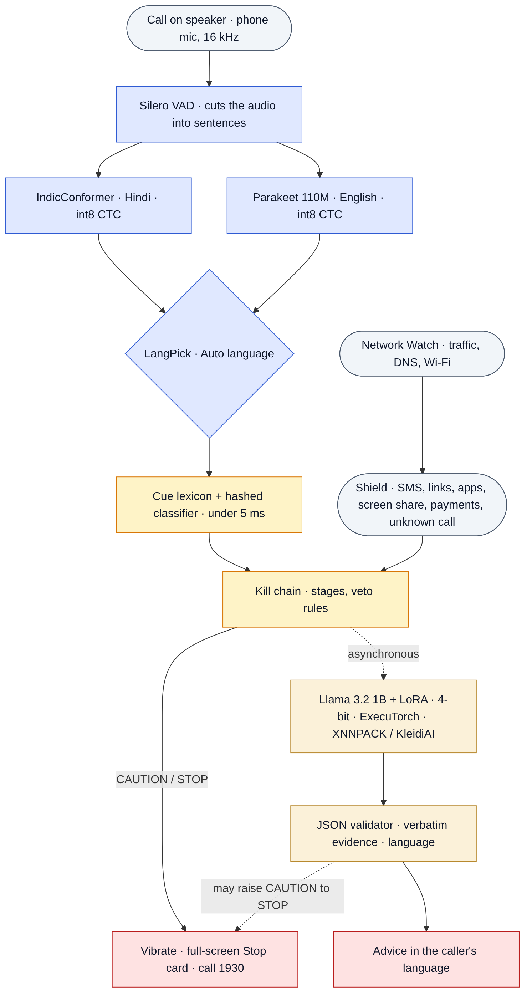

**Team:** Siddhant Singh (call listening: on-device speech recognition, Call Guardian
and the Android app) · Bogavalli Sai Akhilash (detection and Llama: scam playbook, data, classifiers,
LoRA fine-tuning and evaluation) · Shivansh Bose (Shield and Network Watch: messages, links, apps,
payments, network and Wi-Fi checks, privacy and security review) · **Faculty mentor:**
Dr. Rahul Ratnakumar.
All three members worked across every part of the project; the roles name each person's main area.

> **How to read this report.** It describes **one current build** (12 Nov 2026). Every number has a
> row in `docs/EVIDENCE_LEDGER.md` with its source file, sample size and status (reproduced on
> 12 Nov, measured once on the phone, observed, reported from an earlier build, or planned).
> Results from earlier builds that shaped the design are kept in §7 and marked as history.

# 1. Summary

KAVACH is **one Android app on one phone**. When a call comes from a number that is not in the
contacts and the user puts it on speaker, KAVACH listens, recognises Hindi, Hinglish and English
on the phone, and warns **during** the call. It joins what it hears with the SMS, links, app
installs, screen sharing, payment-app use and network activity on the same phone, because Indian
scams move across channels, and a Llama 3.2 1B model on the Arm CPU explains each warning in the
caller's language. **All inference is on the phone**: the main app does not hold Android's
`INTERNET` permission. The only things that can leave the phone are optional and user-enabled
(an SMS to a family member, a Bluetooth link to a second KAVACH phone, and the separate Network
Watch app's DNS forwarding; §6).

**Current shipped configuration**

| Part | What the submitted build uses | Fallback / optional |
|---|---|---|
| Call audio | one phone; the call on speaker; Android's accessibility capture rule (§3.5) | second-phone Bluetooth mode; OEM system mode (untested on a retail phone) |
| Speech | Silero VAD → **AI4Bharat IndicConformer** (Hindi/Hinglish) and **NVIDIA Parakeet 110M** (English), int8 CTC, sentence by sentence; **Auto** language per sentence | small streaming Zipformer models if the big files are absent |
| Detector | cue lexicon (16 categories) + hashed classifier + kill chain, ≈ 4 ms per sentence | — |
| Explanation | Llama 3.2 1B + KAVACH LoRA, ExecuTorch 8da4w `.pte` (820 MB), Arm CPU | playbook text when Llama is missing, slow or invalid |
| Shield | notifications, Link Check, App Inspector, Screen-share Guard, call awareness | — |
| Network Watch | per-app traffic counters in the main app | separate DNS-watch / Wi-Fi-check app |

**Headline results (shipped detector, no Llama; re-run on 12 Nov 2026).** Counts, with Wilson 95 %
intervals where the sample is small:

| Evaluation set | Scam calls reaching STOP | STOP before the money/OTP request | Genuine calls STOPped | Genuine calls at CAUTION |
|---|---|---|---|---|
| Synthetic test, phrasings never trained on (511 / 489) | **477/511 (93.4 %)** | 420/511 (82.2 %) | **0/489** (CI 0–0.8 %) | 29/489 (5.9 %) |
| Same, caller heard through the speaker (502 / 498) | 375/502 (74.7 %) | 304/502 (60.6 %) | **0/498** | 26/498 (5.2 %) |
| Hand-written calls (16 / 14) | 15/16 | 10/16 | **0/14** (CI 0–21.5 %) | 3/14 |
| Locked held-out calls (10 / 10), never used for tuning | 8/10 (CI 49–94 %) | 5/10 | **0/10** (CI 0–28 %) | 4/10 |
| Hindi, telephone band, IndicConformer (50 / 50, TTS voice) | 29/50 (58 %) | 22/50 | **0/50** | 3/50 |
| **Real cellular calls, one phone (2 scam / 1 genuine)** | **2/2** | — | **0/1** | 0/1 |

On the team's phone (Snapdragon 7s Gen 2): detector 4.07 ms per sentence; both speech models
together ≈ 0.2 × real time; one minute of Auto listening drew 385 mA for the whole phone (screen
on), which would be ≈ 7.6 % of the battery per hour if it held for an hour (a sustained run is
planned, §7.8); Llama decodes 11.5–11.9 tokens/s.

**The honest reading.** No genuine call reached STOP in any set, but the samples of genuine calls
written by people other than the generator are small (24 calls), so this does not establish a
false-STOP rate below 2 %. The detector still misses 7–25 % of scam calls depending on the set,
warns before the money step in 50–82 % of them, and raises CAUTION on 5–40 % of genuine calls. A
new cross-channel ablation (§7.10) shows that fusion adds STOPs at the risky action (an APK
install or remote access during a call), but not earlier warnings, and that it can blame a genuine
call for an unrelated scam SMS. Llama can only escalate a warning, never clear one (§3.2). The
20-call human pilot (`demo/pilot20/`) is the next real measure.

# 2. Problem and scope

Indians lost about ₹22,845 crore to cyber fraud in 2024, about 206 % more than in 2023 (Ministry
of Home Affairs reply in the Lok Sabha, July 2025). "Digital arrest" incidents on the National Cyber
Crime Reporting Portal rose from 39,925 in 2022 to 1,23,672 in 2024, with reported losses of about
₹1,935 crore (Rajya Sabha reply, March 2025). A scam is a *sequence*: an authority claim, a threat
or lure, isolation ("don't disconnect, don't tell your family"), an action (OTP, link, APK, screen
share) and a payment. Single-channel filters see one fragment.

Problem Statement 3 asks for on-device AI that detects scam calls and messages, phishing links,
malicious apps and network threats, explains them in plain language and recommends what to do,
with a Llama-family model for the advisory part, run with ExecuTorch. KAVACH targets the
mid-range Android phones most families own.

Since Android 10 ordinary apps cannot record a call. KAVACH listens through the documented
accessibility capture exception while the call is on **speaker** (§3.5). The costs and what we do:

| Cost | What KAVACH does | Section |
|---|---|---|
| The call must be on speaker | the opt-in KAVACH Phone dialer turns the speaker on for unknown numbers after a spoken notice; Shield's call awareness still watches links, apps and payments if the user does not | 3.4, 3.5 |
| Android can silently stop the accessibility service | the app checks that the service is really running and that its recording is not silenced, and shows a Fix button | 3.5, 7.5 |
| Noisy rooms | larger speech models, a placement check, victim-side cues, and fusion with actions that need no audio | 3.1, 7.3 |

# 3. Architecture

{width=52%}

## 3.1 Speech front-end (Arm CPU)

| Stage | Implementation | Notes |
|---|---|---|
| Capture | `AudioRecord`, `VOICE_RECOGNITION` source, 16 kHz mono, 100 ms chunks | gain control and noise suppression off; audio held in memory only |
| VAD | Silero VAD (sherpa-onnx), 512-sample windows | cuts sentences: 0.5 s minimum silence, 12 s maximum |
| Hindi / Hinglish | AI4Bharat IndicConformer Hindi, 120 M parameters, int8 CTC (188.5 MiB) | Devanagari, including English loan words |
| English | NVIDIA Parakeet TDT-CTC 110M, int8 CTC (125.6 MiB) | punctuated English |
| Auto language | both models on every sentence; `LangPick` keeps the transcript whose words are more often real words of its language (wordfreq lists); borderline sentences keep the previous language; warnings follow the majority of the last 3 sentences | §7.4 |
| Fallback | streaming Zipformer2-CTC Hindi (65.8 MiB) and Zipformer English (181 MiB) | only when the big files are missing |
| Placement check | SNR estimate from 20 ms frame powers over 5 s | "good / move closer / too noisy" |
| Own-voice filter | sentences heard while KAVACH speaks, and 1.2 s after, are ignored (and counted in the session log) | warnings are never spoken during a real call |

## 3.2 Llama advisor (Llama 3.2 1B, ExecuTorch, Arm CPU)

| Item | Choice |
|---|---|
| Model | Llama-3.2-1B-Instruct + KAVACH LoRA (r = 16, all projections), merged before export |
| Runtime | ExecuTorch `LlmModule` (Android AAR), XNNPACK delegate (KleidiAI micro-kernels are part of XNNPACK's Arm build; their use is not separately observed on the phone yet) |
| Quantisation | 8da4w: 4-bit groupwise weights (g = 32), 8-bit dynamic activations, 4-bit embeddings; 820 MB |
| When it runs | only after the detector raises CAUTION or STOP, on its own thread; the rule-based warning is shown first |
| Latency | **warm prefix** (the constant system prompt pre-filled into the KV cache at start and re-armed after every alert); **early stop** when the JSON object closes; greedy decoding |
| Timeout | **35 s per generate call** (a re-prompt after invalid JSON gets its own). It covers waiting for a background warm-prefix prefill, the prompt prefill and the generation; not model loading. Set from the phone measurements: warm path ≈ 15 s, cold path of the fine-tuned file ≈ 26 s. It was 25 s in the build measured on 12 Nov; earlier versions of this report wrongly said 8 s. Self-test 60 s, benchmark 90 s |
| Contract | one JSON object: `scam, type, stage, confidence, evidence[≤3 verbatim quotes], say(≤35 words), action` |
| Validator | enums enforced, confidence clamped, quotes not found verbatim in the transcript dropped (confidence capped), unfinished last sentence cut, one re-prompt on invalid output; advice copied from the prompt's example or in the wrong language is replaced by playbook text and labelled |
| Authority | may raise CAUTION → STOP when its *self-reported* confidence ≥ 0.8 and stage ≥ isolation (this threshold is not calibrated); **never lowers or clears a warning**; invalid, timed-out or missing output leaves the rule-based warning unchanged |

## 3.3 The always-on detector

1. **Cue lexicon** (`assets/cues.json`): 698 phrases in 16 categories (police and bank authority,
   identity misuse, threat, urgency, isolation, credential request, remote access, link, payment,
   reward, family emergency, safety advice, and three **victim-side** categories: reading out an
   OTP, saying they are paying, begging not to be arrested), each in English, romanised Hinglish
   and Devanagari, plus 208 mixed-script variants mined from what the Hindi model writes. Phrase
   rules allow gaps of 0–4 words; a request next to a negation ("never share your OTP") is safety advice.
2. **Hashed linear classifiers** (`cue_model`, `sms_model`, `url_model`): FNV-1a hashed words, word
   pairs and 3–5 letter fragments plus cue categories; ≈ 1 MB each; identical in Python and Kotlin;
   every score decomposes into per-word evidence.
3. **Kill chain** (`killchain.py` / `KillChain.kt`): evidence fades with a channel half-life (10 min
   calls, 30 min SMS and links, 24 h apps); the level is sticky within a session. STOP rules:
   isolation + authority; authority + identity + threat; two different action/payment requests;
   hook + action with no safety advice; victim complying with a scam pretext; suspicious call +
   risky action; unknown-number call + dangerous link / APK / remote access / upload; two message
   channels together; total score. CAUTION: score, a payment app in an unknown call longer than
   3 min, authority + hook. The rules use **time only**: they do not compare the organisation a
   caller claims with the sender of a message (§7.10).
4. **Guardian logic**: ticks after every sentence and at least every 3 s; the classifier adds
   CAUTION/STOP above 0.8 on two ticks in a row and can veto a weak rule-only STOP while it is
   confidently benign. Thresholds were tuned on the development sets only.

## 3.4 Shield (same app)

* **Message Shield** reads SMS / WhatsApp / Telegram *notifications* (no SMS permission) and runs
  the SMS classifier, the cues and Link Check on every URL. Notification text is evidence only: it
  is never given to Llama as an instruction.
* **Link Check**: an offline allow-list of genuine Indian domains (including `.bank.in`), look-alike
  rules (brand in an unofficial domain, typosquats, homoglyphs/punycode, shorteners, raw IPs, `@`,
  APK downloads, scam-prone TLDs, free site builders), then the URL model (threshold for ≤ 3 %
  false alarms on dev).
* **Call awareness**: knows that a call with an unknown number is on and for how long, without
  hearing it.
* **App Inspector v0** (preview): scores a new app's permission profile and sideloading.
  **Screen-share Guard v0** (preview): STOP when a payment app comes to the front while a
  remote-access app is *running*. An installed remote-access app alone is not a warning. A warning
  is advice; KAVACH never blocks a payment.
* **STOP card**: full screen, a plain reason, a one-tap call to 1930; an optional SMS to one family member.
* **KAVACH Phone** (opt-in: the user makes KAVACH the phone's call app). A complete phone app: Keypad
  (pressing Call with nothing typed fills in the last number), Recents from the phone's own call log,
  Contacts with search, and a call screen with Answer / Decline, mute, speaker, keypad tones, hold, a
  call timer, the caller's name, a SIM choice on dual-SIM phones, call waiting and screen-off at the ear.
  Incoming calls also raise a call notification with Answer / Decline and a full-screen intent,
  because some phones (Xiaomi's "pop-up windows" rule, Android 14's full-screen permission) block a
  background app from opening the call screen; the Setup tab checks both and opens the right setting.
  For an unknown number it says it is turning on the speaker, then does so; it shows the live KAVACH
  level and, on STOP, a one-tap End call. Telecom still rings and writes the call log. History: in the
  first version, calls rang but could not be answered when KAVACH was the phone app (no call
  notification, and the call screen was blocked). Status: verified on the team's phone on 12 Nov (Xiaomi, Android 15): answering from the call screen and from the notification with the screen locked, declining, Recents and Contacts all worked; hold and a dual-SIM choice were not separately tried.
* **Second-phone link** (optional): Bluetooth RFCOMM with Android pairing, authentication and
  encryption, paired devices only, an 8 KB message cap, and only forwarded event kinds accepted
  with clamped weights (hardened on 12 Nov).

## 3.5 Listening on the same phone

During a call Android gives the microphone to the call and silences other recorders; an enabled
accessibility service is the documented exception. `CallListenAccessService` reads no screen content
and performs no actions. With **Protect my calls** on, listening starts when an unknown-number call
starts. During a real call the warning is not spoken (it would go into the call and block the
listening): the phone vibrates and the STOP card appears.

On 12 Nov changing the default dialer made Android stop KAVACH and mark this service as crashed
while its switch still showed "on"; every recording during a call was then silenced. The app now
compares the enabled setting with the services Android actually runs and checks
`AudioRecordingConfiguration.isClientSilenced()` during a call; both states appear on the
Readiness screen with a Fix button. This fix is verified on the one phone; other phone makers are
not tested. Play-store distribution would need a declared accessibility use case or OEM system
mode (`docs/threat_model.md`, `docs/oem_mode.md`).

## 3.6 Network Watch

* **App traffic watch** in the main app (no `INTERNET`): `NetworkStatsManager` per-app byte counters
  every 30 s; only suspect apps (sideloaded, new, remote-access, rated suspicious) are judged;
  `suspicious_upload` and `beaconing_app`. Detection times below come from simulated 30 s polling;
  the real counter granularity on the phone is not yet checked. A sideloaded backup or sync app is
  flagged by design and can be trusted with "I know this app".
* **Optional DNS-watch app** (`io.kavach.netwatch`, holds `INTERNET`): a local DNS-only `VpnService`
  learns which app looks up which name, forwards the look-up unchanged, and flags bank look-alikes
  and bursts of non-existent machine-generated names. It can miss look-ups made through Private DNS
  or an app's own DNS-over-HTTPS, and it attributes names to apps only as well as Android reports them.
* **Home Wi-Fi check**: connects to 10 commonly abused services on the local /24 of a network the
  user owns. An open port is reported as a risk, not as malware.
* **Flow model** (UNSW-NB15): evaluated, **raises no alerts** (§7.6).

# 4. Arm-specific engineering

| Lever | Status | Evidence |
|---|---|---|
| ExecuTorch + XNNPACK `.pte` | fine-tuned 8da4w file runs on the phone; export verified token by token on a tiny model | `llama_pipeline_check.json`, phone screenshots |
| Quantisation | 8da4w g32 + 4-bit embeddings (820 MB) vs Meta SpinQuant INT4 (1,083 MB): similar decode speed on the phone (11.5 vs 11.6–11.9 tok/s, single runs) | device JSON, self-test |
| KleidiAI on vs off | build script ready (`bench/build_llama_runner.sh`), **not run** | planned |
| Threads | speech RTF measured at 2 and 4 threads (Hindi 0.153 → 0.092); the energy cost of 4 threads is **not measured** | device JSON |
| big.LITTLE | the app logs the core each thread last ran on; no placement claim is made yet | session CSV |
| Battery and heat | one-minute listening sample only; 30-min soak script ready (`bench/thermal_soak.sh`) | planned |
| Fast path | 0.44 ms per tick on a laptop JVM (host baseline, not a LITTLE-core number); 4.07 ms per sentence on the phone, all cores | `kotlin_engine_host.json`, device JSON |

`qmode: int8` failed to export on the GQA projections in ExecuTorch 1.5.1 and `torchao:8da8w` cannot
be combined with XNNPACK (both reproduced on the tiny model), so the shipped file is 4-bit.

# 5. Data

| Need | Source | Use |
|---|---|---|
| Call transcripts | synthetic generator: 11 scam scripts, 9 genuine scenarios, 47 utterance pools (English, Hinglish, Devanagari), ASR-style corruption and timing; paraphrased from I4C, RBI and bank advisories | train 8,000 / dev 600 / test 1,000 |
| Hard negatives | bank alerts that say "never share OTP", delivery OTPs, relatives asking for money, people discussing scams, genuine police, office talk about payments and screen sharing | every split |
| Held-out phrasing | template-disjoint splits (pools partitioned by item) | dev for selection, test reported |
| Caller through speaker | `test_far`: 3× ASR errors on the caller's lines | reported only |
| Independent checks | 30 hand-written calls (other author style); 20 locked held-out calls written before tuning | reported only |
| ASR text | 88 English and 410 Hindi training calls through Piper TTS → channel → recogniser | classifier training |
| SMS | UCI SMS Spam Collection (CC BY 4.0) + 4,300 synthetic Indian messages | `sms_model` |
| URLs | Phishing.Database (MIT), top-10k domains, genuine Indian domains, 8k generated look-alikes | `url_model` |
| Network | UNSW-NB15, NSL-KDD, 25 DGA families + popular domains, simulated per-app traces | Network Watch |
| Llama | 4,000 / 400 instruction pairs from the phone's own prompt code | LoRA |
| Human calls | 20-call locked pilot (`demo/pilot20/`), consented role-play | planned 21 Nov |

No real victim audio or personal data is used or committed.

# 6. Engineering quality, privacy and security

* **One source of truth**: lexicon, playbook, domain lists and weights live in `assets/`.
* **Parity**: `android/core` checks 336 golden outputs from the Python reference (normalisation,
  hashing, lexicon, features, all three models, URL and message verdicts, kill-chain steps, prompts,
  JSON validation, full replays, Network Watch, LangPick). Porting found two real bugs.
* **Tests**: 38 pytest tests (one found that `"scam": "maybe"` was read as *not a scam*).
* **Fail-safe**: if Llama is missing, slow or invalid, the rule path still warns with playbook text.
* **Design**: dark mode is true black with grey cards and a champagne-gold accent (light mode: ivory
  and cobalt); every text colour pair passes the 4.5 : 1 contrast check (`docs/design_tokens.md`); risk is
  always written in words, never shown by colour alone.
* **What can leave the phone** (full table in `docs/EVIDENCE_LEDGER.md`): nothing from the main app's
  inference (no `INTERNET`); an optional SMS to one family member; an optional Bluetooth link to a
  paired KAVACH phone; the optional Network Watch app's DNS forwarding. Audio is never written to
  storage; the session log keeps times, levels, rules, sentence languages and Llama speed (no
  transcript; Llama's own advice is kept when it was replaced, for review).
* **Exported components** are protected by platform permissions (`BIND_INCALL_SERVICE`,
  `BIND_NOTIFICATION_LISTENER_SERVICE`, `BIND_ACCESSIBILITY_SERVICE`); the in-app link uses a
  signature-level permission.

# 7. Results

All host results below were re-run on 12 Nov 2026 with the shipped models unless marked otherwise.

## 7.1 Text classifiers (held-out test splits)

| Model | Task | Test n | Precision | Recall | F1 | ROC-AUC |
|---|---|---|---|---|---|---|
| `cue_model` | 120-token call window → scam | 9,010 | 0.946 | 0.883 | **0.913** | 0.962 |
| `sms_model` | SMS / notification → scam | 1,914 | 0.994 | 0.901 | **0.945** | 0.990 |
| `url_model` (rules + model) | URL → phishing | 10,196 | 0.987 | 0.752 | 0.853 | 0.945 |

Template-disjoint selection mattered: with a dev split that shared templates, the call model looked
perfect on dev (F1 0.999) but scored 0.817 on test (history). **Link Check** flags 98.5 % of generated
Indian look-alikes, 0 % of genuine Indian domains, 3.9 % of popular global domains and 69 % of
generic global phishing domains.

## 7.2 Call-level detection (host, replayed in call time)


| Set (scam / genuine) | Config | STOP | ≥ CAUTION | STOP before money | Median time to STOP | False STOP | False CAUTION |
|---|---|---|---|---|---|---|---|
| Synthetic test (511 / 489) | rules only | 423 (82.8 %) | 472 | 336 (65.8 %) | 17.3 s | 0 | 0 |
| | **shipped** | **477 (93.4 %)** | 508 (99.4 %) | 420 (82.2 %) | 12.6 s | **0** | 29 (5.9 %) |
| Caller through speaker (502 / 498) | rules only | 312 (62.2 %) | 360 | 218 (43.4 %) | 18.9 s | 0 | 0 |
| | **shipped** | **375 (74.7 %)** | 466 (92.8 %) | 304 (60.6 %) | 14.6 s | **0** | 26 (5.2 %) |
| Hand-written (16 / 14) | rules only | 12 | 14 | 7 | 24.7 s | 2 | 3 |
| | **shipped** | **15** | 15 | 10 | 19.0 s | **0** | 3 |
| Locked held-out (10 / 10) | rules only | 5 | 8 | 2 | 21.2 s | 0 | 1 |
| | **shipped** | **8** | 8 | 5 | 21.3 s | **0** | 4 |

The classifier veto removes both rule-only false STOPs on the hand-written set (people *discussing*
a scam; an office call about screen sharing and payments). The 90 % "STOP before money" target is
**not met** (50–82 %), and false CAUTIONs on the small human-written sets are high (3/14, 4/10).
Earlier builds reported 90.6 % / 71.1 % / 70 % on the same sets; the gain comes from the Hindi
lexicon and classifier changes of 11 Nov, which were made for Hindi phone failures, not tuned on
these sets. The held-out set has been scored on several builds and is therefore no longer pristine.

## 7.3 Noisy rooms (host, earlier detector build)

Four scripted calls (2 scam, 2 genuine), Piper TTS, telephone channel, room reverb, fan/traffic hum,
TV or babble at 30, 15, 8, 3 dB: 48 calls per configuration (`bench/e2e_noise.py`).

| English recogniser + front-end | Scam STOP 30 / 15 / 8 / 3 dB | Genuine STOP | WER hum / TV / babble | Host RTF |
|---|---|---|---|---|
| 20M (previous default) | 3/6 · 3/6 · 0/6 · 0/6 | 0/24 | 0.53 / 0.80 / 0.74 | 0.05 |
| 20M + GTCRN speech denoiser | 1/24 in total | 0/24 | 0.48 / 0.97 / 1.13 | +0.08 |
| 20M + scam-word hotwords | 3/24 in total | 0/24 | 0.60 / 0.74 / 0.75 | |
| Zipformer en-2023-06-21 | 6/6 · 6/6 · 4/6 · 2/6 | 0/24 | 0.20 / 0.83 / 0.90 | 0.12 |

The larger model shipped (now the fallback behind Parakeet); the denoiser (invents speech from TV and
babble) and hotwords (+1 call) were rejected. With background voices even the larger model transcribes
the wrong speaker, which is why the app shows a placement check. One TTS realisation per condition:
read these as a direction. Parakeet has not been run through this noise benchmark.

## 7.4 Hindi speech and Auto language

100 unseen synthetic Hindi calls (50 scam, 50 genuine), Piper TTS, decoded by the phone's models:

| Condition | Streaming Hindi model: red / yellow-or-red | IndicConformer: red / yellow-or-red | Genuine → red / yellow (IndicConformer) |
|---|---|---|---|
| near speaker, quiet room | 44 % / 92 % | **66 % / 96 %** | 0 % / 6 % |
| telephone band, SNR 10–30 dB | 0 % / 46 % | **58 % / 86 %** | 0 % / 6 % |

The three genuine calls at yellow are a real traffic-police call and two real card-fraud checks.
Lexicon and classifier fixes alone had moved telephone-band yellow-or-red from 12 % to 44 % with 0 % red;
only the better recogniser made Hindi usable. All audio shares one TTS voice per language.

**Auto language** (held-out split, first two caller sentences of each call, `langpick_test.json`):

| Channel | English chosen for English speech | Hindi chosen for Hindi speech |
|---|---|---|
| telephone band, SNR 10–30 dB | 93.0 % (80/86) | 91.0 % (91/100) |
| near speaker | 87.2 % (75/86) | 99.0 % (99/100) |

Overall 92.7 % (345/372). How much a wrong choice changes the final warning is not yet measured.

## 7.5 On the phone

Phone: Xiaomi 2312DRA50I, Snapdragon 7s Gen 2 (SM7435: 4 × Cortex-A78 2.4 GHz + 4 × Cortex-A55
1.96 GHz), 7.3 GB RAM, **Android 15**, on battery.

**Real cellular calls, one phone (12 Nov 2026, 03:15–03:53): 3/3 as expected (observed).** A teammate
called from a number not in the contacts; the call was answered in the phone's own dialer and put on
speaker; KAVACH started by itself with the language on Auto.

| Call | Result |
|---|---|
| Hindi digital-arrest scam (fake police, Aadhaar parcel, warrant, "tell no one", RBI safe account) | **STOP** during the call |
| English KYC scam (bank KYC, account blocked, SMS link, OTP) | **STOP** during the call; Auto chose English; type "Fake KYC / bank account block" |
| Genuine Hindi bank fraud check ("never share your OTP or PIN") | **no warning** for the whole call |

Three calls by one caller are a demonstration, not a measurement; the 20-call pilot follows (§7.8).

**Replayed test files (12 Nov, laptop speaker 10–30 cm): 6/6 as expected (observed).** Hindi digital
arrest red (twice); Hindi genuine bank call lowest hint only; English digital arrest red; English KYC
red; English delivery and English genuine bank calls no warning. History: in an earlier build two
English scams stopped at yellow because the *spoken* yellow warning muted the microphone for 19–33 s;
yellow warnings are now silent.

**Benchmark (measured once, 12 Nov 01:35, `bench/results/device/kavach_bench_20261112_013528.json`)**

| What | Result |
|---|---|
| Detector (rules + classifier + kill chain) | 4.07 ms per sentence |
| Hindi IndicConformer (sentence) | RTF 0.153 at 2 threads, 0.092 at 4 |
| English Parakeet 110M (sentence) | RTF 0.052 at 2 threads, 0.037 at 4 |
| Small streaming fallback models | Hindi RTF 0.239, English 0.117 at 2 threads |
| Auto listening, **one minute** (VAD + both models, 2 threads each; screen on) | 54 % of one core; **whole-phone** current 385 mA (≈ 7.6 % of 5,100 mAh per hour **if extrapolated**); 38.0 → 37.9 °C; thermal status 0; 235 MB |
| Llama 3.2 1B, **Meta SpinQuant INT4 file** (ExecuTorch, XNNPACK) | load 4.1 s, +1.1 GB; first token 12.9 s cold (768-token prompt) / 5.9 s warm prefix; complete answer 22.0 s cold / 15.1 s warm; prefill 56–60 tok/s; decode 11.6–11.9 tok/s; 858 mA while generating |
| Llama, **KAVACH LoRA 8da4w file** (self-test, observed) | verdict digital_arrest 0.91 with its own advice; first token 18.3 s cold; 11.5 tok/s |

There is no idle baseline yet, so the listening current includes the screen and the rest of the phone.

## 7.6 Network Watch

| Part | Test | Result |
|---|---|---|
| App traffic watch | **simulated** 2-hour traces, 200 per scenario, 30 s polling | spyware uploads, slow exfiltration, heartbeats: 100 % detected (uploads in 30–90 s, heartbeats in 10–35 min); chat, video, streaming, Play backup: 0 % false alarms; a sideloaded backup app is flagged by design |
| Domain model | 6 DGA families never seen in training | cryptolocker 92 %, necurs 92 %; dictionary-word DGAs ≈ 0 % (blind spot); 0.36 % false alarms on 85k popular domains; 0 genuine Indian domains |
| Flow model, UNSW-NB15 | 82,332 test flows | P 0.939, R 0.885, F1 0.911 |
| Flow model, NSL-KDD | KDDTest+ once | F1 0.854 |
| Flow model on phone-like traffic | **replayed capture** | flags 60/60 normal HTTPS sessions (UNSW-NB15 has no normal TLS) → **raises no alerts** |
| Pcap replay demo | browsing + scan + DGA + look-alike + heartbeat + 2.4 MB upload | rules find all 5; none on browsing |
| Home Wi-Fi check | **emulator** network | 254 addresses in 12 s; found the emulator's open ADB port |

## 7.7 Llama 3.2 1B after LoRA fine-tuning (Colab, 12 Nov 2026)

LoRA r = 16 on all projections, 1 epoch over 4,000 pairs on a free T4 (4.1 h; training loss 0.111,
dev loss 0.041), merged and exported with ExecuTorch 1.4. Scored with `models/llama/eval_llama.py` on
the first 100 dev examples, **full-precision merged model** (`llama_lora_colab.json`):

| Metric | Base Llama 3.2 1B | + KAVACH LoRA |
|---|---|---|
| valid JSON verdict | 71 % | **100 %** |
| scam / not scam correct | 38 % | **89 %** |
| scam type correct | 58 % | **76 %** |
| warning stage correct | 71 % | **100 %** |
| quoted evidence really in the transcript | 8 % | **96 %** |
| advice copied from the prompt's example | 32 % | **0 %** |
| advice in the call's language | 55 % | **100 %** |

These examples come from the training generator and are not ASR text; the deployed 4-bit `.pte` has
not been scored on an independent set (planned, §7.8). On the phone the 4-bit file wrote its own advice
in English and Hindi (`docs/media/llama_phone.jpg`); its Hindi is understandable but not always
polished, and one earlier Hindi run was replaced by playbook text (now logged).

## 7.8 Still to measure (scripts ready)

* **20-call human pilot** (`demo/pilot20/`, scoring `bench/pilot20_report.py`): frozen build, 10 scam /
  10 genuine, 4 Hindi / 3 English / 3 Hinglish each, speaker-balanced, two independent annotators.
* Deployed 4-bit Llama on independent, ASR and prompt-injection prompts (`docs/OWNER_CHECKLIST.md`).
* 30-minute listening soak with an idle baseline; 2 vs 4 threads energy; KleidiAI on/off.
* Fusion with Llama escalation (configuration E of §7.10).
* Reliability: screen lock, backgrounding, missing/corrupt model, permission revoked, dialer change.
* KAVACH Phone: hold, call waiting and a dual-SIM call (basic answering is verified).

## 7.9 PS3 scope coverage

| PS3 expectation | KAVACH component | Status |
|---|---|---|
| Scam / fraud call detection on device | call listening → detector → kill chain → Llama | built; synthetic, hand-written, held-out, TTS-audio sets; 3 real calls |
| Phishing SMS / messages | Message Shield | built, F1 0.945 (synthetic + UCI) |
| Malicious links | Link Check | built |
| Malicious / fake apps | App Inspector | v0 preview, not evaluated on malware data |
| Screen-sharing / remote-access fraud | Screen-share Guard + kill chain | v0 preview |
| Network threats | Network Watch | rules evaluated in simulation and replay; flow model research only |
| Cross-channel correlation | kill-chain hub | built; ablation in §7.10 |
| On-device, privacy-preserving | no `INTERNET` in the main app; audio never stored | by construction; optional paths in §6 |
| Explainable alerts in Indian languages | Hindi / English reasons, Llama explanation | observed on the phone; quality measured on dev data |
| Arm optimisation | ExecuTorch + XNNPACK, int8 ASR, 4-bit Llama | measured on one phone; ablations planned |

## 7.10 Does cross-channel fusion help? (new, 12 Nov)

`bench/fusion_ablation.py` replays **identical** timestamped event traces under five configurations:
**A** the call detector alone; **B** message / link / app detectors alone, with no knowledge of the call;
**C** A and B combined independently (the higher level wins, no correlation); **B+** Shield with call
awareness but no listening; **D** full fusion exactly as wired in the app (the listener gets the
forwarded actions; Shield's kill chain gets every event, the call start/end and the listener's
CAUTION/STOP; the user sees the higher of the two). **E** (D + Llama) is not run on the host. Calls come
from the caller-through-speaker test set; SMS texts are 8 scam and 4 genuine team-written examples;
40 sessions per template; thresholds are the shipped ones (nothing tuned here); the plan was written in
the script before the first run, and the dev split was used to debug the harness.

| Scam template (40 each) | A STOP | C STOP | B+ STOP | **D STOP** | Warned before the risky step: C / D |
|---|---|---|---|---|---|
| scam call alone | 37 | 37 | 0 | **37** | 31 / 31 |
| + scam SMS with a link mid-call | 32 | 40 | 40 | **40** | 38 / 38 |
| + APK install | 30 | 30 | 40 | **40** | 32 / 32 |
| + remote access, then a payment app | 36 | 36 | 40 | **40** | 29 / 29 |
| scam SMS 5 min before the call | 30 | 37 | 33 | **40** | 37 / 37 |
| first 40 % of the call, then an APK | 7 | 7 | 40 | **40** | 26 / 26 |

| Genuine template (40 each) | C STOP (tied to the call) | **D STOP (tied to the call)** | D ≥ CAUTION |
|---|---|---|---|
| genuine call alone | 0 (0) | **0 (0)** | 5 |
| + unrelated scam SMS mid-call | 32 (0) | **40 (32)** | 40 |
| + scam SMS 20 min after the call | 32 (0) | **32 (3)** | 40 |
| + payment app opened during the call | 0 (0) | **4 (4)** | 4 |
| + risky APK installed 2 days earlier | 0 (0) | **0 (0)** | 2 |
| + genuine bank SMS, duplicated and reordered | 0 (0) | **0 (0)** | 3 |
| + screen sharing for work, no payment | 0 (0) | **40 (40)** | 40 |

**Reading.** Fusion turns an ambiguous call into STOP **at the risky action** (APK install +10/40,
remote access +4/40, a call heard only in part +33/40), but it gives **no earlier warning** than the
independent combination in any template. Most of that gain comes from *knowing a call with an unknown
number is on* (B+), not from what was heard; the speech adds +3/40 when a scam SMS arrived 5 min before
the call. The costs are real: an unrelated scam SMS during a genuine call is blamed on the call
(32/40), a genuine work screen-share during an unknown-number call is STOP (40/40) by design, and a
payment app opened in a genuine call is STOP 4/40. The rules link events by time only; matching the
organisation named on the call with the message sender is the Phase 2 fix. These are synthetic traces
replayed on the host; replay timing is not live Android latency.

# 8. Limitations and threat model

* **Speech is the dominant error source.** Human voices on speaker-phone calls are measured only by
  three real calls; all other audio uses one TTS voice per language. TV or other people talking near
  the phone is the hardest case.
* **Synthetic data**, written by the team; the hand-written and held-out sets reduce but do not remove
  author bias. Zero false STOPs on 24 human-written genuine calls does not establish a ≤ 2 % rate.
* **Before-payment warnings** (50–82 %) are below the 90 % target; false CAUTIONs on human-written genuine
  calls are frequent. Llama only escalates, so it cannot reduce false CAUTIONs.
* **Fusion is temporal only** (§7.10): it can blame a genuine call for an unrelated message.
* **Llama** is evaluated in full precision on generator data; the deployed 4-bit file is only observed.
  Its confidence is self-reported, not calibrated. Prompt-injection resistance rests on the contract
  (Llama cannot lower a warning; quotes must be verbatim), not on a measured attack success rate.
* **Adversaries** can avoid trigger words; the classifier, category combinations, Llama and actions
  that need no audio partly compensate.
* **Platform**: the call must be on speaker; one-phone listening relies on the accessibility capture
  rule and was tested on one Xiaomi phone; Play policy limits accessibility use (`docs/threat_model.md`).
* **Battery** is a one-minute sample; Network Watch numbers come from simulation, replay and an emulator.

# 9. Phase 2 plan

1. Human-recorded test set (100+ scam, 100+ genuine, consented), Hindi WER, recogniser adaptation.
2. Deployed-Llama evaluation (independent, ASR, injection prompts) and the Llama escalation effect (E).
3. Entity-aware fusion (organisation on the call vs message sender) to remove the §7.10 false blames.
4. Sustained energy (30–60 min with an idle baseline), 2 vs 4 threads, KleidiAI on/off, big vs LITTLE,
   a budget phone, and NPU offload of the speech encoders.
5. App Inspector on public malware data; flow model retrained on Android traffic; dictionary-DGA detection.
6. Consent-based pilot with 20–30 family volunteers; formative usability tests with 3–5 new users.

# 10. Reproducing everything

```bash
pip install numpy scipy scikit-learn pytest            # core + tests
./data/public/download.sh                              # public datasets
python data/synth/generate_calls.py && python data/synth/generate_sms.py && python data/dev/build_handwritten.py
python models/classifiers/train_text.py && python models/classifiers/train_url.py
for s in dev test test_far handwritten heldout; do python bench/eval_calls.py --split $s --json bench/results/calls_$s.json; done
python bench/fusion_ablation.py --split test_far --n 40                 # §7.10
python -m pytest -q tests && python tests/make_parity_vectors.py
cd android && ./gradlew :core:test                      # Kotlin parity (336 checks)
python models/netwatch/train_domain.py && python models/netwatch/train_ids.py
python bench/netwatch_sim.py && python bench/netwatch_pcap_demo.py
python bench/e2e_noise.py --asr zipformer-en-2023-06-21 --configs base hotwords
scripts/build_apks.sh                                  # debug APKs (needs Android SDK)
# Llama: notebooks/kavach_llama_lora_colab.ipynb on a Colab T4
```

Sources: Ministry of Home Affairs replies in Parliament (Lok Sabha, July 2025: cyber-fraud losses;
Rajya Sabha, March 2025: digital-arrest incidents), as reported by Scroll and PTI/Inc42; RBI circular
RBI/2025-26/28 (`.bank.in`); model and data licences in `docs/model_cards.md`, `docs/data_card.md` and `NOTICE.md`.
